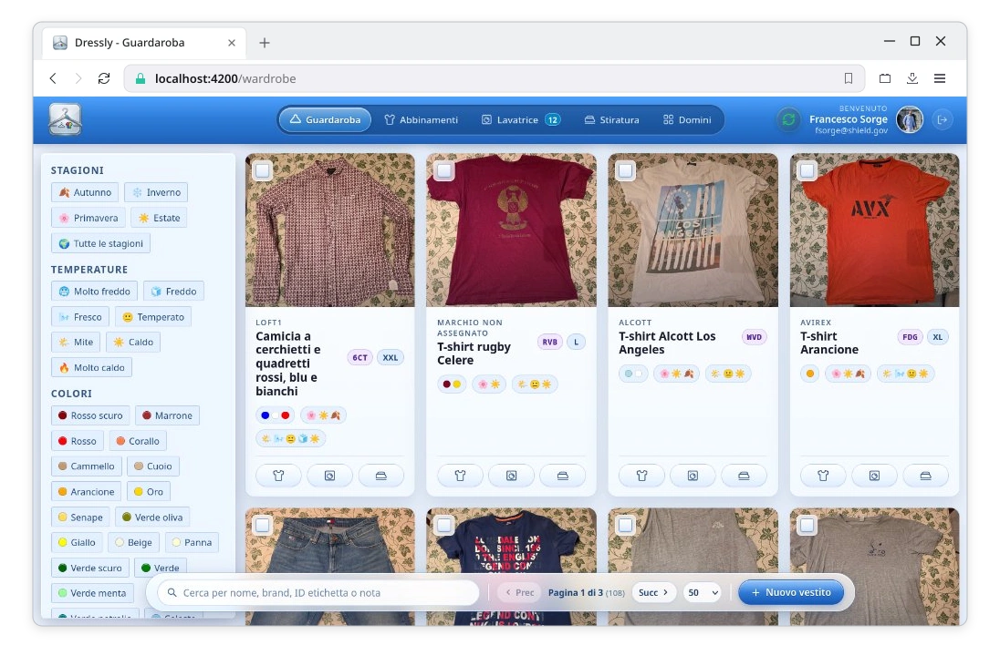
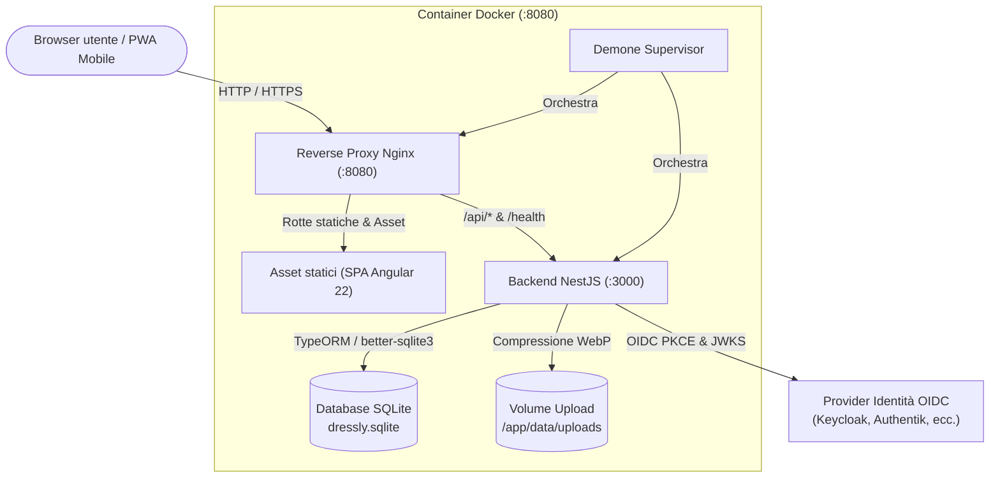

# Dressly

[](https://github.com/sorge13248/dressly)
[](LICENSE)
[](https://angular.dev/)
[](https://nestjs.com/)
[](https://sqlite.org/)
[](https://web.dev/progressive-web-apps/)

> [!NOTE]
> Leggi questa documentazione in lingua inglese: **[README.md](./README.md)**.

**Dressly** è una web app moderna, orientata alla privacy e self-hostable per la gestione del guardaroba digitale, la pianificazione degli outfit e il controllo del ciclo del bucato. Permette di catalogare capi di abbigliamento, allegare foto ad alta risoluzione con generazione automatica di anteprime WebP ottimizzate, tracciare le code di lavaggio e stiratura, generare codici etichetta fisici di 3 caratteri, comporre outfit su una canvas interattiva 2D e usufruire di una Progressive Web App (PWA) completamente funzionante offline con sincronizzazione bidirezionale.

Il progetto è strutturato come un monorepo npm leggero con frontend in **Angular 22** e backend in **NestJS 12**, con persistenza su database locale **SQLite** tramite **TypeORM** (`better-sqlite3`).

<p align="center">
  
</p>

## 🌟 Perché esiste Dressly?

Le tipiche applicazioni per la gestione del guardaroba presentano spesso tracciamento cloud invasivo, interfacce sovraccariche, assenza di supporto offline e incapacità di gestire il reale flusso di lavaggio dei capi. Dressly nasce con obiettivi precisi:

- **Proprietà completa dei dati e privacy**: Dati rigorosamente isolati per singolo utente. Nessuna telemetria esterna né dipendenze da database cloud di terze parti.
- **Resilienza offline-first**: Progressive Web App (PWA) completa basata su IndexedDB nel browser. Consulta il guardaroba e le istruzioni di lavaggio ovunque, anche in lavanderia, in aereo o in locali senza copertura di rete.
- **Sicurezza con pattern BFF (Backend-for-Frontend)**: Nessun token di autenticazione in `localStorage`. Flusso riservato OpenID Connect (OIDC) con PKCE e cookie cifrati `HttpOnly`, `SameSite=Lax`.
- **Integrazione con il guardaroba fisico**: Codici etichetta di 3 caratteri (es. `K7P`, `9XB`) progettati per essere scritti a mano sulle etichette dei capi con pennarelli per tessuti indelebili.
- **Canvas interattiva 2D per outfit**: Trascina, ridimensiona, ruota e sovrapponi i capi graficamente per comporre abbinamenti in modo intuitivo.
- **Gestione operativa del bucato**: Code dedicate per Lavaggio e Stiratura con supporto a capi singoli o cumulativi a quantità multipla (es. confezioni di calzini o t-shirt identiche).

---

## ⚡ Funzionalità principali (v1.4.0)

- 🔒 **Autenticazione OIDC confidenziale**: Accesso sicuro con Keycloak, Authentik, Google o qualunque provider OIDC conforme tramite PKCE e cookie di sessione protetti.
- 👔 **Catalogo capi completo**: Tracciamento dettagliato di tipo capo, brand, vestibilità, materiali, colori primari e secondari, stagioni, temperature, occasioni d'uso, taglia e note.
- 📦 **Cambio di stagione & Posizioni di deposito**: Gestione realistica del cambio armadio stagionale con 3 stati operativi (`in_wardrobe` - nell'armadio, `in_storage` - in deposito, `dismissed` - dismesso) e gerarchia di contenitori fisici (Stanze e Posizioni/Scatole). Include una procedura guidata in 5 passaggi (`/wardrobe/seasonal-change`) con selezione multi-stagione, mantenimento intelligente dei capi multi-stagione adatti anche alle stagioni entranti, visualizzazione capi in formato card mini, blocco di sicurezza sulle modifiche non salvate (`canDeactivate`), integrazione diretta nelle code di lavaggio e stiratura e avvisi amichevoli sulle schede degli outfit contenenti capi riposti.
- ↕️ **Motore di ordinamento guardaroba multi-criterio**: Ordinamento capi per data di aggiunta (recenti/meno recenti), nome alfabetico (A-Z/Z-A), gerarchia di vestizione consigliata (dalla parte superiore alle calzature), tipologia A-Z, stagionalità smart (stagione astronomica corrente in cima), ciclo annuale, codice etichetta e disponibilità puliti/lavanderia. Integrato nel pannello fluttuante inferiore con sincronizzazione parametri URL e persistenza locale.
- 🏷️ **Sistema di codici etichetta a 3 caratteri**: Codici alfanumerici univoci generati da un set di 30 caratteri privo di ambiguità (`23456789ABCDEFGHJKMNPQRSTVWXYZ`), escludendo caratteri facilmente confondibili a mano (`0`/`O`, `1`/`I`/`L` e `U`), con verifica immediata di unicità offline su IndexedDB durante la digitazione nell'editor (feedback visivo verde/rosso e icona V/X).
- 🧺 **Code bucato (Lavaggio e Stiratura)**: Monitoraggio dei capi in lavaggio o in attesa di stiratura. Spostamento atomico dei capi da lavaggio a stiratura con un singolo clic.
- 📦 **Supporto capi cumulativi e quantità multipla**: Gestione di gruppi di capi identici (es. 5 paia di calzini uguali) con allocazione parziale nelle code del bucato.
- 🎨 **Outfit con Canvas interattiva 2D**: Creazione e stile degli outfit su superficie 2D. Supporta selezione multipla tramite rettangolo di selezione (marquee), trascinamento di gruppo, rotazione, ridimensionamento e ordinamento dei livelli z-index, con segnalazione di capi in deposito.
- 🧼 **Istruzioni di cura e dettagli di acquisto**: Gestione di temperature di lavaggio (incluso lavaggio a freddo), tipo di lavaggio, candeggio, modalità di asciugatura, temperature di stiratura, uso del vapore e dettagli di acquisto con prezzo e negozio.
- 📄 **Esportazione scheda tecnica in PDF vettoriale**: Esportazione istantanea con un clic del singolo capo in formato PDF pronto per la stampa direttamente dalla barra inferiore di dettaglio, con anteprima fotografica principale, badge di stato, codice etichetta a 3 caratteri, griglia dei simboli di cura e dati di acquisto.
- 💾 **Disaster Recovery completo & Portabilità ZIP multi-istanza**: Esportazione e ripristino integrale di tutti i dati utente (capi, outfit, cataloghi di riferimento, code bucato e allegati fotografici ad alta risoluzione) in un archivio ZIP portatile. Supporta sia la modalità "Sostituisci tutto" (ripristino pulito dell'istanza) sia la modalità "Unisci" (deduplica intelligente dei cataloghi, risoluzione automatica delle collisioni dei codici a 3 caratteri e risoluzione dei conflitti di denominazione) posizionato esclusivamente nella pagina di Gestione domini.
- 📸 **Elaborazione immagini ad alte prestazioni**: Upload fino a 10MB gestiti da `sharp` con correzione automatica dell'orientamento EXIF, anteprime responsive e compressione progressiva WebP. Include recupero resiliente nell'editor (in caso di upload parzialmente fallito il capo creato viene preservato, l'editor passa in modalità modifica con `Location.replaceState`, mostra le cause puntuali di errore per ciascun file e permette il retry immediato con "Aggiorna").
- 🔄 **Sincronizzazione offline bidirezionale**: Riconciliazione automatica tra IndexedDB locale (`dressly_offline_v1`) e il server con risoluzione conflitti a livello di campo Last-Write-Wins (LWW) e tracciamento delle eliminazioni tramite tombstone.
- 📲 **PWA installabile**: Interfaccia ottimizzata per dispositivi mobili con rispetto dei safe-area insets, barre d'azione fluttuanti con navigazione compatta a sole icone su schermi ridotti, Service Worker personalizzato per la memorizzazione nella cache e notifiche di aggiornamento in-app.
- 🗂️ **Gestione dati di riferimento personali**: Cataloghi configurabili per singolo utente per colori, brand, stagioni, temperature, occasioni d'uso, vestibilità, materiali, tipi, stanze, posizioni e tag personalizzati.

---

## 🏗️ Architettura del sistema



Per consultare approfondimenti tecnici dettagliati su ogni componente, visita la suite di documentazione tecnica in lingua inglese:

| Documento | Descrizione |
| :--- | :--- |
| 📖 **[System Architecture](docs/ARCHITECTURE.md)** | Pattern di sicurezza BFF, topologia di runtime, architettura del container e routing delle richieste. |
| 💾 **[Data Model & Schema](docs/DATA_MODEL.md)** | Schema ERD completo, entità TypeORM, vincoli di unicità, relazioni a cascata e indici. |
| 🔐 **[Authentication & Security](docs/AUTHENTICATION.md)** | Flusso OIDC PKCE, gestione dei cookie protetti, verifica JWT via JWKS e auto-seeding utenti. |
| 📡 **[REST API Reference](docs/API_REFERENCE.md)** | Catalogo completo degli endpoint REST con schemi di richiesta/risposta e parametri di filtro. |
| 🔄 **[Offline-First & Synchronization](docs/OFFLINE_SYNC.md)** | Struttura degli object store IndexedDB, risoluzione conflitti LWW, tracciamento tombstone e code di sincronizzazione. |
| 👔 **[Wardrobe & Domain Logic](docs/WARDROBE_FEATURES.md)** | Matematica dei codici etichetta a 3 caratteri, code operative del bucato, canvas 2D per outfit ed elaborazione immagini con Sharp. |
| 🎨 **[Frontend Architecture](docs/FRONTEND_ARCHITECTURE.md)** | Componenti standalone Angular 22, segnali reattivi, design tokens SCSS e strategie di cache del Service Worker. |
| 🚀 **[Deployment & DevOps](docs/DEPLOYMENT_AND_DEVOPS.md)** | Dockerfile multi-stage, configurazione Supervisor, proxy Nginx, docker-compose e pipeline CI/CD GitHub Actions. |
| 🤖 **[LLM & Agent Guidelines](docs/LLM_GUIDELINES.md)** | Invarianti architetturali, cheat-sheet della struttura del codice e convenzioni per assistenti di programmazione AI. |
| 📋 **[AI Agent Operating Instructions](AGENTS.md)** | Istruzioni operative universali per agenti AI, comandi di verifica e regole obbligatorie di documentazione diretta. |

---

## 🛠️ Stack tecnologico

| Ambito | Tecnologia | Dettagli |
| :--- | :--- | :--- |
| **Framework Frontend** | **Angular 22** | Componenti standalone, routing standalone, segnali reattivi (`signal`, `computed`) |
| **Stile e UI** | **SCSS & CDK** | Token di stile via custom properties CSS, `@angular/cdk/dialog`, `@angular/cdk/overlay` |
| **Persistenza Client** | **IndexedDB API** | Gestione locale avanzata tramite `OfflineStorageService` (`dressly_offline_v1`, v2) |
| **PWA & Offline** | **Web Service Worker** | File `sw.js` personalizzato con Network-First per navigazione e Stale-While-Revalidate per asset statici |
| **Test Frontend** | **Vitest 4** | Suite di test veloci su ambiente JSDOM (`ng test --watch=false`) |
| **Framework Backend** | **NestJS 12** | Piattaforma Express, controller modulari, guard e interceptor |
| **ORM e Database** | **TypeORM & SQLite** | `typeorm` v1.1 + `better-sqlite3` v12 con supporto WAL |
| **Elaborazione Immagini** | **Sharp** | Compressione grafica basata su libvips ad alte prestazioni con output WebP |
| **Esportazione Documenti** | **PDFKit** | Generazione vettoriale PDF server-side con dimensionamento automatico delle immagini e tipografia pulita |
| **Archivio & Backup** | **Adm-Zip** | Creazione pacchetti ZIP in streaming e motore di ripristino multi-istanza protetto da transazioni |
| **Sicurezza e Auth** | **Jose & Crypto** | Flusso confidenziale OpenID Connect, PKCE (`S256`), convalida firme tramite JWKS |
| **Container Runtime** | **Docker & Supervisor** | Nginx e NestJS coordinati in un unico container slim |
| **Pipeline CI / CD** | **GitHub Actions** | Build Docker multi-architettura native (`linux/amd64`, `linux/arm64`) e rilascio semantico |

---

## 📂 Struttura del repository

```text
.
├── backend/                  # API NestJS, entità TypeORM, servizi, controller, seed
│   ├── src/
│   │   ├── common/           # Guard di autenticazione, decoratori, tipi sync, utilità codici
│   │   ├── controllers/      # Controller REST API (capi, outfit, sync, categorie)
│   │   ├── entities/         # Entità TypeORM per SQLite
│   │   ├── services/         # Logica di business e repository SQLite
│   │   └── database/         # Configurazione data source e script di seed
│   └── package.json
├── frontend/                 # Applicazione SPA Angular 22 (PWA)
│   ├── src/app/
│   │   ├── core/             # Servizi: api, auth, sync, storage offline, bucato, pwa
│   │   ├── features/         # Funzionalità: guardaroba, outfit, categorie, auth, errori
│   │   ├── layout/           # AppShellComponent con barra superiore, contatori e stato sync
│   │   └── shared/           # Componenti riutilizzabili (window frame, modali, dropdown, bottoni)
│   ├── public/               # Asset statici, manifest.webmanifest e sw.js
│   └── package.json
├── deploy/                   # Configurazioni runtime (supervisord.conf, nginx.unified.conf)
├── docs/                     # Suite completa di documentazione tecnica (in inglese)
├── AGENTS.md                 # Istruzioni operative e regole universali per agenti AI
├── Dockerfile                # Build container multi-stage per produzione
├── docker-compose.yml        # Setup Docker Compose per avvio unificato
├── supervisord.conf          # Configurazione Supervisor per ambiente locale
├── LICENSE                   # Licenza GNU Affero General Public License v3.0
├── README.md                 # Documentazione principale in inglese
└── README.it.md              # Documentazione in italiano
```

---

## 🚀 Guida all'avvio rapido

### Prerequisiti
- **Node.js**: consigliata versione `v22.x` o superiore.
- **npm**: versione `v11.x` o superiore.
- **Provider OIDC**: un provider OpenID Connect raggiungibile (Keycloak, Authentik, Authelia, Google Cloud).
- **Docker e Docker Compose** (Opzionale, per esecuzione in container).

---

### 1. Installa le dipendenze
Dalla directory principale del progetto, installa le dipendenze per entrambi i moduli:

```bash
npm --prefix frontend install
npm --prefix backend install
```

---

### 2. Configura le variabili d'ambiente
Crea un file `.env` nella radice del repository (il backend cerca prioritariamente `../.env` rispetto alla propria cartella):

```env
# Porta del server e CORS
PORT=3000
CORS_ALLOWED_ORIGINS=http://localhost:4200

# Database SQLite
DB_PATH=../dressly.sqlite
DB_SYNCHRONIZE=true
DB_LOGGING=false

# Configurazione Provider OIDC
OIDC_ISSUER_URL=https://tuo-idp.example.com/realms/dressly
OIDC_CLIENT_ID=dressly
OIDC_CLIENT_SECRET=segreto-client-confidenziale
OIDC_REDIRECT_URI=http://localhost:3000/api/auth/callback
OIDC_FRONTEND_REDIRECT_BASE_URL=http://localhost:4200

# Utente per il seed iniziale
SEED_USER_SUBJECT=local-dev-user
SEED_USER_EMAIL=dev@example.com
SEED_USER_DISPLAY_NAME=Local Dev User
```

> [!IMPORTANT]
> - `OIDC_REDIRECT_URI` deve corrispondere all'URI di reindirizzamento configurato nel provider OIDC e puntare al **backend**, non al frontend.
> - `OIDC_CLIENT_SECRET` è obbligatorio per il flusso riservato gestito dal backend.
> - `CORS_ALLOWED_ORIGINS` deve includere l'origine del server di sviluppo Angular (`http://localhost:4200`).

---

### 3. Esegui il seed iniziale del database (Opzionale)
Popola il database con i cataloghi di default per l'utente di sviluppo:

```bash
npm --prefix backend run seed:run
```

*(Nota: il backend esegue automaticamente il seed dei dati di base al primo accesso autenticato di qualsiasi utente tramite `GET /api/me`.)*

---

### 4. Avvia i server di sviluppo
Apri due terminali separati dalla directory radice:

**Terminale 1 (Backend API):**
```bash
npm run start:backend
```

**Terminale 2 (Frontend SPA):**
```bash
npm run start:frontend
```

Apri il browser su:
- **Frontend**: `http://localhost:4200`
- **Health check backend**: `http://localhost:3000/health`

---

## 🐳 Esecuzione tramite Docker

Dressly include un `Dockerfile` multi-stage pronto per la produzione e un file `docker-compose.yml` che pubblicano l'intera applicazione sulla porta `8080`.

### Avvio del container
```bash
docker compose up -d --build
```

### Funzionamento nel container
- **Unico container con doppio processo**: Supervisor gestisce contemporaneamente il backend NestJS sulla porta 3000 e Nginx sulla porta 8080.
- **Persistenza dei dati**: Il database SQLite e gli allegati multimediali sono salvati nel volume Docker `dressly-backend-data` montato in `/app/data`.
- **Health check**: Verifica periodica automatica su `http://127.0.0.1:8080/health` ogni 10 secondi.

---

## 📜 Script NPM disponibili

### Radice
- `npm run start:frontend`: Avvia il server di sviluppo Angular con proxy configurato.
- `npm run start:backend`: Avvia NestJS in watch mode.
- `npm run build`: Compila i bundle di produzione per frontend e backend.
- `npm run test`: Esegue i test su frontend e backend.
- `npm run lint`: Esegue ESLint sul codice sorgente del backend.

### Backend (`backend/`)
- `npm --prefix backend run build`: Compila il codice TypeScript tramite Nest CLI.
- `npm --prefix backend run start:dev`: Avvia NestJS con ricaricamento a caldo.
- `npm --prefix backend run start`: Avvia il build di produzione compilato (`node dist/main.js`).
- `npm --prefix backend run seed:run`: Esegue lo script di seed via `tsx`.
- `npm --prefix backend run test`: Esegue la suite di test dei servizi e della sincronizzazione via `tsx`.

### Frontend (`frontend/`)
- `npm --prefix frontend run start`: Avvia `ng serve` su `http://localhost:4200`.
- `npm --prefix frontend run start:lan`: Avvia `ng serve --host 0.0.0.0` per test da smartphone o altri dispositivi nella rete locale.
- `npm --prefix frontend run start:lan:ssl`: Avvia `ng serve` con certificato SSL auto-firmato per test PWA su dispositivi mobili.
- `npm --prefix frontend run build`: Genera la build di produzione in `dist/`.
- `npm --prefix frontend run test`: Esegue la suite di test con Vitest (`31 file di test, oltre 230 test superati`).

---

## 🔧 Risoluzione dei problemi comuni

### Il login non funziona o restituisce 401 Unauthorized
1. Controlla che `OIDC_ISSUER_URL`, `OIDC_CLIENT_ID` e `OIDC_CLIENT_SECRET` siano impostati correttamente.
2. Assicurati che nelle impostazioni del provider OIDC l'URI di reindirizzamento valido includa `http://localhost:3000/api/auth/callback` (o l'URL pubblico di produzione).
3. Verifica che `CORS_ALLOWED_ORIGINS` contenga l'host del frontend.

### Il caricamento delle foto fallisce con errore 413 Payload Too Large
- Se utilizzi Docker o un reverse proxy Nginx esterno, assicurati che la direttiva `client_max_body_size 10m;` sia impostata. Dressly supporta foto scattate da fotocamere di smartphone fino a 10MB.

### Le modifiche offline non vengono sincronizzate
1. Verifica che il browser non sia in una modalità di navigazione anonima ultra-restrittiva con IndexedDB disattivato.
2. Controlla l'indicatore di stato di sincronizzazione nella barra di navigazione superiore. Se segnala `conflict`, consulta il pannello di sincronizzazione per visualizzare i dettagli dei campi in conflitto.

---

## 📄 Licenza

Dressly è un software open source distribuito con licenza **GNU Affero General Public License v3.0 o successiva (AGPL-3.0-or-later)**.

Il testo completo della licenza è disponibile nel file [LICENSE](./LICENSE).
