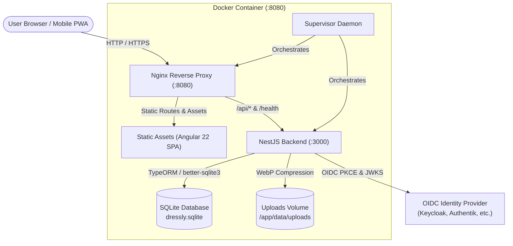

# Dressly

[](https://github.com/sorge13248/dressly)
[](LICENSE)
[](https://angular.dev/)
[](https://nestjs.com/)
[](https://sqlite.org/)
[](https://web.dev/progressive-web-apps/)

> [!NOTE]
> Read this documentation in Italian: **[README.it.md](./README.it.md)**.

**Dressly** is a modern, private-first digital wardrobe, outfit composition planner, and laundry management system. It enables users to catalog clothes, attach high-resolution photos with auto-optimized WebP previews, track washing and ironing queues, generate physical 3-character tag labels, compose outfits on an interactive 2D canvas, and enjoy seamless offline-first Progressive Web App (PWA) resilience with bi-directional synchronization.

The project is structured as a lightweight npm monorepo with an **Angular 22** frontend and a **NestJS 12** backend, persisting to a local **SQLite** database via **TypeORM** (`better-sqlite3`).

---

## 🌟 Why Dressly?

Traditional wardrobe apps often suffer from invasive cloud tracking, cluttered interfaces, lack of offline reliability, or inability to handle real-world physical laundry workflows. Dressly was engineered with clear priorities:

- **Complete Data Ownership & Privacy**: Strictly isolated single-user data partition. Zero external telemetry or third-party cloud database dependencies.
- **Offline-First Reliability**: Full Progressive Web App (PWA) backed by in-browser IndexedDB. Browse your wardrobe and care instructions anywhere—even in basements, laundromats, or during flights.
- **BFF Security Pattern**: Zero authentication tokens in `localStorage`. OpenID Connect (OIDC) confidential authorization code flow with PKCE and encrypted `HttpOnly`, `SameSite=Lax` cookies.
- **Real-World Physical Wardrobe Bridging**: 3-character marker-friendly tag codes (e.g. `K7P`, `9XB`) designed for quick handwriting on physical clothing tags with permanent laundry markers.
- **Interactive 2D Outfit Canvas**: Drag, drop, scale, rotate, and layer clothes visually to design looks without guessing.
- **Laundry Lifecycle Operations**: Dedicated queues for Washing and Ironing supporting both unique garments and cumulative multi-quantity stacks (e.g. packs of socks or plain shirts).

---

## ⚡ Key Features (v1.4.0)

- 🔒 **OIDC Confidential Authentication**: Seamless single sign-on with Keycloak, Authentik, Google, or any compliant OIDC Identity Provider via PKCE and secure cookies.
- 👔 **Comprehensive Clothing Catalog**: Detailed tracking of category, brand, fit, fabric materials, primary and secondary colors, suitable seasons, temperatures, use cases, size, and notes.
- 🏷️ **Unique 3-Character Tag Code System**: Collision-free alphanumeric codes drawn from an unambiguous 30-character set (`23456789ABCDEFGHJKMNPQRSTVWXYZ`) excluding easily confused characters (`0`/`O`, `1`/`I`/`L`, and `U`).
- 🧺 **Laundry Queues (Washing & Ironing)**: Track clothes currently in the wash or waiting to be ironed. Move items atomically from washing to ironing with one click.
- 📦 **Cumulative Items & Multi-Quantity Support**: Track stacks of identical clothing (e.g. 5 identical pairs of socks) with partial laundry allocation.
- 🎨 **Outfits with Interactive 2D Canvas**: Visually assemble and style outfits on a 2D surface. Supports multi-select bounding marquees, group dragging, rotation, scaling, and z-index ordering.
- 🧼 **Garment Care & Purchase Tracking**: Full support for wash temperatures (including cold wash), washing types, bleaching rules, drying methods, ironing temperatures, steam permissions, and purchase metadata.
- 📸 **High-Performance Media Pipeline**: Upload images up to 10MB. Powered by `sharp` with automatic EXIF orientation, responsive thumbnails, and progressive WebP compression.
- 🔄 **Bi-Directional Offline Synchronization**: Automatic reconciliation between local IndexedDB (`dressly_offline_v1`) and the server with field-level Last-Write-Wins (LWW) and tombstone tracking.
- 📲 **Installable PWA**: Responsive mobile-first UI with safe-area insets, custom Service Worker caching, and in-app update notifications.
- 🗂️ **Personal Reference Data Management**: User-scoped catalogs for colors, brands, seasons, temperatures, occasions, fits, materials, types, and custom tags.

---

## 🏗️ Architecture Overview



For comprehensive deep dives into each subsystem, explore the documentation suite:

| Document | Description |
| :--- | :--- |
| 📖 **[System Architecture](docs/ARCHITECTURE.md)** | BFF security pattern, runtime topology, container design, and request routing. |
| 💾 **[Data Model & Schema](docs/DATA_MODEL.md)** | Complete Entity-Relationship Diagram (ERD), tables, constraints, cascades, and indexes. |
| 🔐 **[Authentication & Security](docs/AUTHENTICATION.md)** | OIDC PKCE flow, cookie storage, JWKS token verification, and automated user provisioning. |
| 📡 **[REST API Reference](docs/API_REFERENCE.md)** | Full OpenAPI-style endpoint catalog with request/response schemas and query filters. |
| 🔄 **[Offline-First & Synchronization](docs/OFFLINE_SYNC.md)** | IndexedDB database layout, LWW conflict resolution, tombstone deletion tracking, and sync queues. |
| 👔 **[Wardrobe & Domain Logic](docs/WARDROBE_FEATURES.md)** | 3-char tag code math, laundry operational queues, outfits 2D canvas, and Sharp media processing. |
| 🎨 **[Frontend Architecture](docs/FRONTEND_ARCHITECTURE.md)** | Angular 22 standalone components, signals, SCSS design system, and Service Worker caching. |
| 🚀 **[Deployment & DevOps](docs/DEPLOYMENT_AND_DEVOPS.md)** | Multi-stage Dockerfile, Supervisor, Nginx proxy, docker-compose, and GitHub Actions CI/CD. |
| 🤖 **[LLM & Agent Guidelines](docs/LLM_GUIDELINES.md)** | High-density architectural invariants, directory cheat-sheets, and rules for AI coding assistants. |

---

## 🛠️ Technology Stack

| Domain | Technology | Details |
| :--- | :--- | :--- |
| **Frontend Framework** | **Angular 22** | Standalone components, standalone routing, reactive signals |
| **Frontend Styling** | **SCSS & CDK** | CSS custom property tokens, `@angular/cdk/dialog`, `@angular/cdk/overlay` |
| **Client Storage** | **IndexedDB API** | Bespoke `OfflineStorageService` (`dressly_offline_v1`, v2) |
| **PWA & Offline** | **Web Service Worker** | Custom `sw.js` with Network-First navigation and Stale-While-Revalidate assets |
| **Frontend Testing** | **Vitest 4** | JSDOM test environment (`ng test --watch=false`) |
| **Backend Framework** | **NestJS 12** | Express platform, modular controllers, decorators, and interceptors |
| **ORM & Database** | **TypeORM & SQLite** | `typeorm` v1.1 + `better-sqlite3` v12 with WAL support |
| **Image Processing** | **Sharp** | High-performance C-libvips image transformations and WebP generation |
| **Authentication** | **Jose & Crypto** | OpenID Connect, PKCE (`S256`), remote JWKS signature validation |
| **Runtime Container** | **Docker & Supervisor** | Nginx + NestJS managed concurrently in a single slim container |
| **CI / CD Pipeline** | **GitHub Actions** | Native multi-architecture (`linux/amd64`, `linux/arm64`) Docker builds |

---

## 📂 Repository Structure

```text
.
├── backend/                  # NestJS API, TypeORM entities, services, controllers, seed
│   ├── src/
│   │   ├── common/           # Auth guards, decorators, sync types, tag code utility
│   │   ├── controllers/      # REST API controllers (clothes, outfits, sync, domains)
│   │   ├── entities/         # TypeORM entity definitions
│   │   ├── services/         # Domain services and SQLite repositories
│   │   └── database/         # Database dataSource and seed runner
│   └── package.json
├── frontend/                 # Angular 22 Single-Page Application (PWA)
│   ├── src/app/
│   │   ├── core/             # Services: api, auth, sync, offline-storage, laundry, pwa
│   │   ├── features/         # Features: wardrobe, outfits, reference-data, auth, errors
│   │   ├── layout/           # AppShellComponent with navigation header & counters
│   │   └── shared/           # Reusable UI components (modals, dropdowns, buttons)
│   ├── public/               # Static assets, manifest.webmanifest, and sw.js
│   └── package.json
├── deploy/                   # Container configurations (supervisord.conf, nginx.unified.conf)
├── docs/                     # Comprehensive technical documentation suite
├── Dockerfile                # Multi-stage production container build
├── docker-compose.yml        # Docker Compose deployment setup
├── supervisord.conf          # Root development/local supervisor config
├── LICENSE                   # GNU Affero General Public License v3.0
└── README.md                 # Primary documentation portal
```

---

## 🚀 Quickstart Guide

### Prerequisites
- **Node.js**: `v22.x` or higher recommended.
- **npm**: `v11.x` or higher.
- **OIDC Provider**: A reachable OpenID Connect provider (Keycloak, Authentik, Authelia, or Google Cloud).
- **Docker & Docker Compose** (Optional, for containerized execution).

---

### Step 1: Install Dependencies
From the repository root, install dependencies for both frontend and backend:

```bash
npm --prefix frontend install
npm --prefix backend install
```

---

### Step 2: Configure Environment Variables
Create a `.env` file in the repository root (the backend reads `../.env` relative to the backend directory):

```env
# Application Server
PORT=3000
CORS_ALLOWED_ORIGINS=http://localhost:4200

# SQLite Persistence
DB_PATH=../dressly.sqlite
DB_SYNCHRONIZE=true
DB_LOGGING=false

# OIDC Identity Provider Configuration
OIDC_ISSUER_URL=https://your-idp.example.com/realms/dressly
OIDC_CLIENT_ID=dressly
OIDC_CLIENT_SECRET=your-confidential-client-secret
OIDC_REDIRECT_URI=http://localhost:3000/api/auth/callback
OIDC_FRONTEND_REDIRECT_BASE_URL=http://localhost:4200

# Initial Seeding
SEED_USER_SUBJECT=local-dev-user
SEED_USER_EMAIL=dev@example.com
SEED_USER_DISPLAY_NAME=Local Dev User
```

> [!IMPORTANT]
> - `OIDC_REDIRECT_URI` must match the callback URI configured at your IdP and point to the **backend** callback, not the frontend.
> - `OIDC_CLIENT_SECRET` is required for the backend confidential client flow.
> - `CORS_ALLOWED_ORIGINS` must include the Angular development server origin (`http://localhost:4200`).

---

### Step 3: Run Database Seed (Optional for First Run)
Populate the database with default reference data catalogs for the development user:

```bash
npm --prefix backend run seed:run
```

*(Note: The backend also seeds reference data automatically when any authenticated user logs in for the first time via `GET /api/me`.)*

---

### Step 4: Launch Development Servers
Open two separate terminal windows from the root:

**Terminal 1 (Backend API):**
```bash
npm run start:backend
```

**Terminal 2 (Frontend SPA):**
```bash
npm run start:frontend
```

Then open your browser:
- **Frontend Application**: `http://localhost:4200`
- **Backend Health Check**: `http://localhost:3000/health`

---

## 🐳 Deployment with Docker

Dressly provides an optimized multi-stage `Dockerfile` and `docker-compose.yml` publishing a unified container on port `8080`.

### Launching the Container
```bash
docker compose up -d --build
```

### Container Execution Mechanics
- **Single Container, Dual Process**: Supervisor runs both the compiled NestJS API on port 3000 and Nginx on port 8080.
- **Persistent Data**: SQLite database and uploaded media are persisted in the named Docker volume `dressly-backend-data` mounted at `/app/data`.
- **Health Probing**: The container healthcheck probes `http://127.0.0.1:8080/health` every 10 seconds.

---

## 📜 Available NPM Scripts

### Root Scripts
- `npm run start:frontend`: Starts Angular development server with proxy.
- `npm run start:backend`: Starts NestJS in development watch mode.
- `npm run build`: Compiles production builds of both frontend and backend.
- `npm run test`: Runs unit tests across both frontend and backend.
- `npm run lint`: Runs ESLint on backend source code.

### Backend Scripts (`backend/`)
- `npm --prefix backend run build`: Compiles TypeScript with Nest CLI.
- `npm --prefix backend run start:dev`: Runs NestJS in watch mode.
- `npm --prefix backend run start`: Runs production build (`node dist/main.js`).
- `npm --prefix backend run seed:run`: Executes `src/database/seed.ts` via `tsx`.
- `npm --prefix backend run test`: Runs sync and domain service test suites via `tsx`.

### Frontend Scripts (`frontend/`)
- `npm --prefix frontend run start`: Starts `ng serve` on `http://localhost:4200`.
- `npm --prefix frontend run start:lan`: Starts `ng serve --host 0.0.0.0` for local network device testing.
- `npm --prefix frontend run start:lan:ssl`: Starts `ng serve` with self-signed SSL for mobile PWA testing.
- `npm --prefix frontend run build`: Compiles production Angular distribution to `dist/`.
- `npm --prefix frontend run test`: Runs the Vitest unit test suite (`31 test files, 230+ tests`).

---

## 🔧 Common Troubleshooting

### Login redirects fail or result in 401 Unauthorized
1. Verify that `OIDC_ISSUER_URL`, `OIDC_CLIENT_ID`, and `OIDC_CLIENT_SECRET` match your identity provider.
2. Ensure the IdP client has `Valid Redirect URIs` set to `http://localhost:3000/api/auth/callback` (or your production callback URL).
3. Ensure `CORS_ALLOWED_ORIGINS` matches the frontend host and port.

### Photo uploads fail with 413 Payload Too Large
- If using Docker or Nginx reverse proxies, ensure `client_max_body_size 10m;` is enabled. Dressly supports photos up to 10MB.

### Offline changes do not synchronize
1. Ensure your browser is not in an ultra-strict private mode that completely disables IndexedDB.
2. Look at the synchronization indicator badge in the top navigation bar. If in `conflict`, open the sync panel to review conflicting fields.

---

## 📄 License

Dressly is open-source software licensed under the **GNU Affero General Public License v3.0 or later (AGPL-3.0-or-later)**.

The full license text is available in the [LICENSE](./LICENSE) file.
