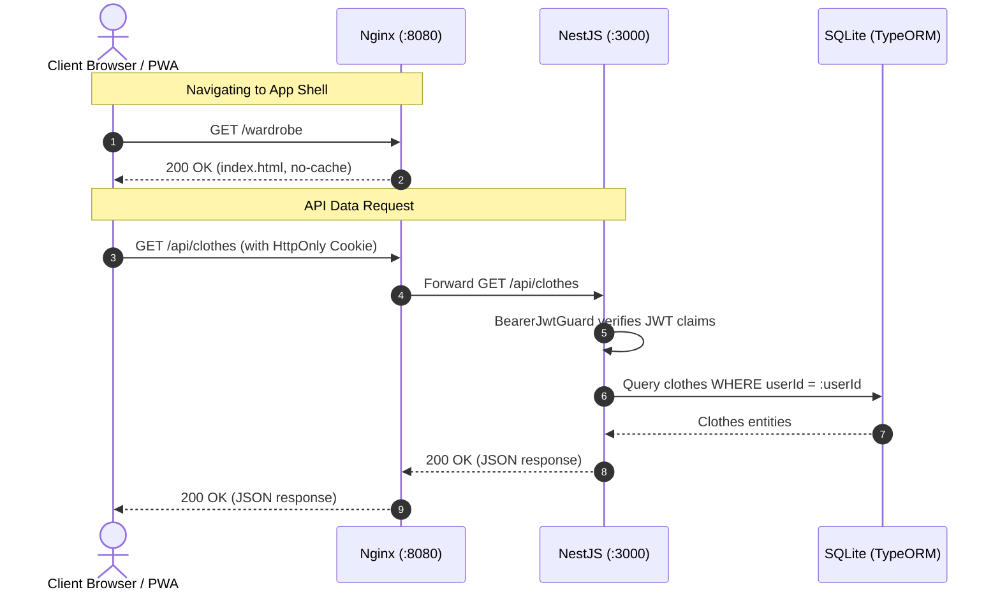

# System Architecture

This document describes the high-level architecture of **Dressly**, explaining the structural patterns, system components, deployment topology, and communication flows across the application stack.

---

## 1. Architectural Principles & Philosophy

Dressly is designed as a modern, private-first, self-hostable digital wardrobe and laundry management system. The architecture is guided by the following core principles:

1. **Backend-for-Frontend (BFF) Security Pattern**: The browser client never handles or stores sensitive tokens (e.g. OIDC access/refresh tokens in `localStorage`). All token exchanges happen securely in the backend, and authenticated sessions are maintained via encrypted `HttpOnly`, `SameSite=Lax` cookies.
2. **Offline-First & Local-First Resilience**: Users can browse their wardrobe, check clothing care instructions, manage laundry buckets, and edit outfits even without internet access. Local modifications are staged in IndexedDB and synchronized with the backend via a bi-directional conflict-resilient synchronization engine upon reconnection.
3. **Strict Data Isolation**: Every piece of domain data (clothes, reference categories, laundry items, outfits, uploads) is strictly partitioned by `userId`. Cross-user data leakage is impossible at both database and query levels.
4. **Lightweight & Self-Contained Runtime**: Both the Angular Single-Page Application (SPA) and the NestJS REST API can run together in a single lightweight Docker container managed by Supervisor, backed by a local SQLite database requiring zero external database services.

---

## 2. High-Level System Topology

Dressly supports two operational environments:

### Containerized Production Topology
In production, a single Docker container serves both the compiled Angular frontend and the NestJS backend via an internal Nginx reverse proxy. A Supervisor daemon monitors and manages both processes:

```mermaid
graph TD
    Client(["User Device / Browser / PWA"])

    subgraph DockerContainer ["Dressly Docker Container (:8080)"]
        Supervisor["Supervisor Daemon"]
        Nginx["Nginx Reverse Proxy (:8080)"]
        StaticRoot["Static Assets (/usr/share/nginx/html)"]
        NestJS["NestJS Backend (:3000)"]
        SQLiteDB[("SQLite Database<br/>/app/data/dressly.sqlite")]
        MediaDir[("Uploads Volume<br/>/app/data/uploads")]
    end

    OIDCProvider["OIDC Identity Provider<br/>(Keycloak, Authentik, Authelia, Google, etc.)"]

    Supervisor -->|Manages| Nginx
    Supervisor -->|Manages| NestJS

    Client -->|HTTP / HTTPS (:8080)| Nginx
    Nginx -->|Static Files, PWA Shell, Cacheable Assets| StaticRoot
    Nginx -->|Proxy /api/* & /health| NestJS
    NestJS -->|OIDC PKCE Exchange & JWKS Verification| OIDCProvider
    NestJS -->|TypeORM / better-sqlite3| SQLiteDB
    NestJS -->|Sharp Processed WebP| MediaDir
```

### Local Development Topology
In local development, the frontend and backend run as independent Node processes with hot-reloading:
- **Angular Dev Server**: Hosted on `http://localhost:4200` via Angular CLI (`ng serve`).
- **Dev Reverse Proxy**: Configured via `frontend/proxy.conf.json` forwarding `/api/*` and `/oidc/*` to `http://localhost:3000`.
- **NestJS Dev Server**: Hosted on `http://localhost:3000` via Nest CLI (`nest start --watch`).
- **SQLite Database**: Stored at `../dressly.sqlite` relative to the backend folder.
- **Media Uploads**: Stored at `backend/uploads/clothes/...`.

---

## 3. Request Flow & Routing

### Nginx Routing Strategy (Production)
The Nginx configuration (`deploy/nginx.unified.conf`) handles ingress traffic with distinct caching and security policies:

| Route Path | Destination | Caching Policy | Purpose |
| :--- | :--- | :--- | :--- |
| `/health` | NestJS `http://127.0.0.1:3000/health` | No cache | Container health probes (Docker, Kubernetes) |
| `/config.json` | Static file | `Cache-Control: "no-store"` | Dynamic frontend runtime configuration |
| `/api/*` | NestJS `http://127.0.0.1:3000` | Passthrough (no-cache) | REST API, Auth, Media, Sync endpoints |
| `/sw.js` | Static file | `no-cache, no-store, must-revalidate` | PWA Service Worker (ensures instant updates) |
| `/manifest.webmanifest` | Static file | `Cache-Control: "no-cache"` | Web application manifest |
| `*.{css,js,woff2,webp,...}` | Static file | `public, max-age=31536000, immutable` | Fingerprinted static assets |
| `/` (fallback) | `index.html` | `no-cache, no-store, must-revalidate` | SPA routing fallback |



---

## 4. Subsystems Overview

### 4.1. Authentication Subsystem
- **Standard**: OpenID Connect (OIDC) Confidential Authorization Code Flow with PKCE (`S256`).
- **Guard Layer**: `BearerJwtGuard` extracts JWT from `dressly_at` cookie or `Authorization: Bearer` header, retrieves the provider's JWKS public keys using `jose`, and validates signatures and expirations.
- **User Provisioning**: `UsersService.ensureUser()` automatically creates user records in the local SQLite database upon first login and seeds default reference catalogs (colors, types, seasons, materials, etc.).
- See [AUTHENTICATION.md](./AUTHENTICATION.md) for detailed flow charts.

### 4.2. Wardrobe & Laundry Domain
- **Clothing Catalog**: Master inventory tracking items by brand, category, fit, material, colors, seasons, temperatures, tags, purchase details, and care instructions.
- **Unique Tag Code System**: 3-character marker-friendly identifier (e.g. `K7P`, `9XB`) generated from a 30-character unambiguous charset (`23456789ABCDEFGHJKMNPQRSTVWXYZ`) allowing physical tagging of physical clothes.
- **Laundry State Engine**: Interactive queues for Washing and Ironing. Supports both individual clothing pieces and cumulative items with multi-quantity tracking.
- See [WARDROBE_FEATURES.md](./WARDROBE_FEATURES.md) for full mechanics.

### 4.3. Outfits & 2D Canvas Subsystem
- **Compositions**: Dynamic aggregation of clothes representing styled outfits with season, temperature, and use-case tags.
- **Interactive 2D Canvas**: Drag-and-drop workspace recording 2D positioning (`x`, `y`), scaling, rotation, and z-index layering for clothing imagery.
- See [WARDROBE_FEATURES.md](./WARDROBE_FEATURES.md).

### 4.4. Media Pipeline Subsystem
- **Upload Ingress**: Handles multi-part image uploads up to 10MB (aligned across Nginx `client_max_body_size`, Multer middleware, and frontend validators).
- **Processing Engine**: Powered by `sharp`. Converts images into optimized WebP formats and automatically computes responsive thumbnails/previews with progressive quality degradation until within target byte limits.
- **Storage**: Media files are stored on disk with paths tracked in SQLite.

### 4.5. Offline Synchronization Subsystem
- **Client Store**: Browser-based IndexedDB database (`dressly_offline_v1`) maintaining local replicas of clothes, reference catalogs, laundry status, and outfits.
- **Sync Protocol**: Bi-directional HTTP payload sent to `POST /api/sync`.
- **Conflict Resolution**: Field-level Last-Write-Wins (LWW) with server-side tombstone tracking (`SyncTombstone`) to reconcile deletions made while offline.
- See [OFFLINE_SYNC.md](./OFFLINE_SYNC.md).

---

## 5. Technology Stack Summary

| Layer | Technology | Key Libraries / Modules |
| :--- | :--- | :--- |
| **Frontend Framework** | Angular 22 | `@angular/core`, `@angular/router`, `@angular/forms`, `@angular/common` |
| **Frontend UI / UX** | Angular CDK & SCSS | `@angular/cdk/dialog`, `@angular/cdk/overlay`, Custom Design Tokens |
| **State Management** | Angular Signals & RxJS | `signal()`, `computed()`, `effect()`, `firstValueFrom` |
| **Client Storage** | IndexedDB API | Custom `OfflineStorageService` |
| **PWA & Offline Shell** | Web Service Worker | Custom `sw.js`, Web App Manifest (`manifest.webmanifest`) |
| **Frontend Testing** | Vitest & JSDOM | `vitest`, `jsdom` |
| **Backend Framework** | NestJS 12 | `@nestjs/core`, `@nestjs/common`, `@nestjs/platform-express` |
| **ORM & Database** | TypeORM & SQLite | `typeorm`, `better-sqlite3` |
| **Image Processing** | Sharp | `sharp` (libvips C-bindings) |
| **Security & Auth** | Jose | `jose` (JWT verification, JWKS caching), Node `crypto` (PKCE) |
| **Runtime & Process** | Docker & Supervisor | `supervisord`, `nginx`, `node:slim` |
| **CI / CD Automation** | GitHub Actions | Docker Buildx, GHCR, Multi-architecture (amd64 / arm64) |
