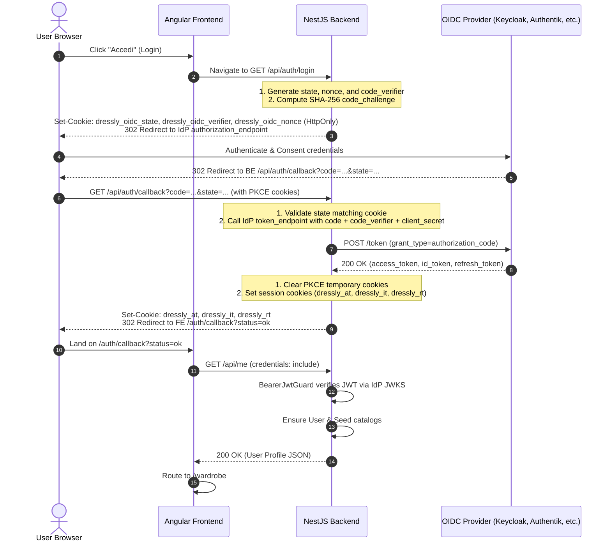
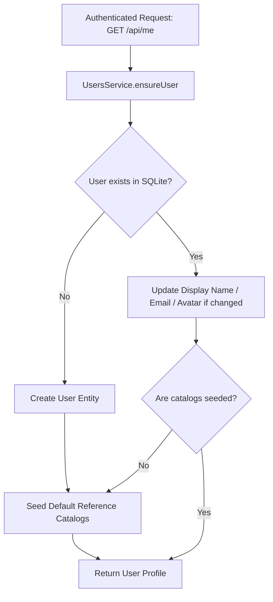

# Authentication & Security Architecture

This document describes the authentication system, OpenID Connect (OIDC) implementation, cookie-based session management, and JWT verification mechanisms used in **Dressly**.

---

## 1. Security Model: Backend-for-Frontend (BFF)

Dressly implements a **Backend-for-Frontend (BFF)** security architecture:

1. **No Client-Side Token Storage**: The Single-Page Application (SPA) never stores access tokens or refresh tokens in `localStorage`, `sessionStorage`, or JavaScript memory variables. This eliminates token exfiltration risks via Cross-Site Scripting (XSS).
2. **Confidential Client Credentials**: The OIDC `client_secret` is held strictly on the NestJS backend and is never exposed to the frontend bundle or client network traffic.
3. **Encrypted HttpOnly Cookies**: Tokens issued by the Identity Provider (IdP) are stored in secure, `HttpOnly`, `SameSite=Lax` browser cookies.
4. **Transparent API Delegation**: The frontend invokes `/api/*` endpoints with standard browser credential forwarding (`credentials: 'include'`). The backend guards extract and validate the session cookies before routing requests.

---

## 2. OIDC Authentication Flow with PKCE

Dressly employs the **OIDC Authorization Code Flow with Proof Key for Code Exchange (PKCE)** using the `S256` code challenge method.



---

## 3. Cookie Management

Session and PKCE cookies are configured in `backend/src/auth.controller.ts`:

| Cookie Name | Purpose | HttpOnly | SameSite | Expiration |
| :--- | :--- | :---: | :---: | :--- |
| `dressly_oidc_state` | CSRF mitigation during OIDC login | Yes | Lax | 10 minutes |
| `dressly_oidc_verifier` | PKCE code verifier for token exchange | Yes | Lax | 10 minutes |
| `dressly_oidc_nonce` | ID token replay mitigation | Yes | Lax | 10 minutes |
| `dressly_at` | OIDC Access Token | Yes | Lax | Token `expires_in` (or default 1h) |
| `dressly_it` | OIDC ID Token (contains user profile claims) | Yes | Lax | Token `expires_in` (or default 1h) |
| `dressly_rt` | OIDC Refresh Token | Yes | Lax | 30 days (`2592000000 ms`) |

In production environments (or when served over HTTPS), all cookies are stamped with the `Secure` flag.

---

## 4. Token Refresh & Logout

### 4.1. Token Refresh (`POST /api/auth/refresh`)
When the frontend detects or anticipates token expiry (or receives a `401 Unauthorized`), it calls the refresh endpoint:
1. Backend reads the `dressly_rt` cookie.
2. If missing, all session cookies are cleared and `401 Unauthorized` is returned.
3. Backend performs an authorization grant (`grant_type=refresh_token`) against the OIDC token endpoint using `client_id` and `client_secret`.
4. Backend updates the `dressly_at`, `dressly_it`, and rotated `dressly_rt` cookies.
5. Returns `{ refreshed: true, expiresIn: number }`.

### 4.2. Logout (`POST /api/auth/logout`)
1. Clears all PKCE cookies.
2. Clears all session cookies (`dressly_at`, `dressly_it`, `dressly_rt`).
3. Returns `{ loggedOut: true }`.

---

## 5. JWT Guard & Verification (`BearerJwtGuard`)

The NestJS `BearerJwtGuard` (`backend/src/common/auth/bearer-jwt.guard.ts`) guards all protected routes:

### 5.1. Token Extraction
The guard extracts the access token using the following precedence:
1. `Authorization: Bearer <token>` header (used by programmatic clients or testing harnesses).
2. `dressly_at` cookie value.

### 5.2. Cryptographic Validation via Remote JWKS
Using the `jose` library:
- Resolves the OIDC provider's JWKS (JSON Web Key Set) endpoint dynamically from `/.well-known/openid-configuration`.
- Validates the signature using asymmetric public keys cached from the provider (`createRemoteJWKSet`).
- Validates standard claims (`exp`, `nbf`, `iss`).

### 5.3. Profile Enrichment from ID Token
Identity providers frequently configure access tokens with minimal claims (omitting email or display name). If `dressly_at` lacks `email`, `name`, or `preferred_username`, `BearerJwtGuard` automatically inspects and verifies the accompanying `dressly_it` (ID token) to enrich the transient `AuthUser` object:

```typescript
export interface AuthUser {
  id: string;          // User ID or subject
  subject: string;     // Unique OIDC subject identifier (sub)
  email: string | null;
  displayName: string;
  pictureUrl: string | null;
}
```

---

## 6. Automated User Provisioning & Catalog Seeding

When an authenticated user invokes `GET /api/me` (handled by `CurrentUserController`):



1. **User Auto-Creation**: If `User` does not exist matching `subject` or `email`, a new record is created in SQLite.
2. **Profile Sync**: Updates `displayName`, `email`, and `pictureUrl` if modified at the IdP.
3. **Default Seed Trigger**: If the user has zero seeded colors or types, `UsersService.seedReferenceDataForUser()` automatically populates the user's personal catalogs with default entries (colors, clothing types, seasons, temperatures, use cases, fits, materials).

---

## 7. Required Environment Configuration

The backend relies on the following environment variables:

```env
# OIDC Provider Configuration
OIDC_ISSUER_URL=https://auth.example.com/realms/dressly
OIDC_CLIENT_ID=dressly
OIDC_CLIENT_SECRET=super-secret-key-from-idp
OIDC_REDIRECT_URI=http://localhost:3000/api/auth/callback
OIDC_FRONTEND_REDIRECT_BASE_URL=http://localhost:4200

# CORS (Allowed origins for credentials sharing)
CORS_ALLOWED_ORIGINS=http://localhost:4200
```
