# Data Model & Database Schema

This document details the database schema, entity-relationship architecture, constraints, and cascading behaviors of the **Dressly** application.

Dressly uses **SQLite** through **TypeORM** and the high-performance **`better-sqlite3`** driver.

---

## 1. Entity-Relationship Diagram (ERD)

The following Mermaid diagram outlines the relationships among core entities, reference catalogs, care instructions, operational queues, and outfits:

```mermaid
erDiagram
    User ||--o{ Clothes : owns
    User ||--o{ Outfit : creates
    User ||--o{ WashingItem : tracks
    User ||--o{ IroningItem : tracks
    User ||--o{ SyncTombstone : records
    User ||--o{ Color : configures
    User ||--o{ Brand : configures
    User ||--o{ Fit : configures
    User ||--o{ Material : configures
    User ||--o{ Season : configures
    User ||--o{ Tag : configures
    User ||--o{ Temperature : configures
    User ||--o{ Type : configures
    User ||--o{ UseCase : configures
    User ||--o{ Room : configures

    Room ||--o{ Location : contains

    Clothes ||--o{ Attachment : has
    Clothes ||--o| WashingInstruction : specifies
    Clothes ||--o| DryingInstruction : specifies
    Clothes ||--o| IroningInstruction : specifies
    Clothes ||--o| BuyDetail : records
    Clothes ||--o{ WashingItem : enters
    Clothes ||--o{ IroningItem : enters

    Clothes }o--o| Brand : "brandId (SET NULL)"
    Clothes }o--o| Fit : "fitId (SET NULL)"
    Clothes }o--o| Type : "typeId (SET NULL)"
    Clothes }o--o| Location : "locationId (SET NULL)"

    Clothes }o--o{ Color : "clothes_colors"
    Clothes }o--o{ Material : "clothes_materials"
    Clothes }o--o{ Season : "clothes_seasons"
    Clothes }o--o{ Temperature : "clothes_temperatures"
    Clothes }o--o{ UseCase : "clothes_use_cases"
    Clothes }o--o{ Tag : "clothes_tags"

    Outfit ||--o{ Attachment : has
    Outfit }o--o{ Clothes : "outfit_clothes"
    Outfit }o--o{ Season : "outfit_seasons"
    Outfit }o--o{ Temperature : "outfit_temperatures"
    Outfit }o--o{ UseCase : "outfit_use_cases"
```



---

## 2. Core Entities

### 2.1. User (`users`)
Represents an authenticated account provisioned via OIDC.

| Column | Type | Constraints / Attributes | Description |
| :--- | :--- | :--- | :--- |
| `id` | `varchar` (UUID) | Primary Key, Auto-generated | Internal unique user identifier |
| `subject` | `varchar` | Unique, Not Null | OIDC `sub` claim |
| `email` | `varchar` | Nullable | User email address |
| `displayName` | `varchar` | Not Null | Display name (or fallback `Dressly user`) |
| `pictureUrl` | `varchar` | Nullable | Avatar URL |
| `createdAt` | `datetime` | Not Null, Auto-generated | Account provisioning timestamp |
| `updatedAt` | `datetime` | Not Null, Auto-generated | Last profile update timestamp |

---

### 2.2. Clothes (`clothes`)
The primary inventory item in the user's wardrobe.

| Column | Type | Constraints / Attributes | Description |
| :--- | :--- | :--- | :--- |
| `id` | `varchar` (UUID) | Primary Key, Auto-generated | Unique identifier |
| `userId` | `varchar` | Indexed, Not Null | Owner user ID |
| `code` | `varchar(3)` | Indexed, Nullable | 3-char unique tag code (e.g. `K7P`) |
| `name` | `varchar` | Nullable | User-assigned clothing title |
| `size` | `varchar` | Nullable | Size notation (e.g. `M`, `42`, `32/34`) |
| `notes` | `varchar` | Nullable | Free-form notes |
| `isCumulative` | `boolean` | Default: `false`, Not Null | Whether the item represents a stack/group |
| `quantity` | `integer` | Default: `1`, Not Null | Total units possessed |
| `brandId` | `varchar` | Nullable, FK `Brand` (`SET NULL`) | Reference to Brand |
| `fitId` | `varchar` | Nullable, FK `Fit` (`SET NULL`) | Reference to Fit |
| `typeId` | `varchar` | Nullable, FK `Type` (`SET NULL`) | Reference to Clothing Type |
| `locationId` | `varchar` | Nullable, FK `Location` (`SET NULL`) | Reference to Storage Location / Box |
| `status` | `varchar` | Default: `'in_wardrobe'`, Not Null | Status: `'in_wardrobe'`, `'in_storage'`, or `'dismissed'` |
| `createdAt` | `datetime` | Not Null, Auto-generated | Creation timestamp |
| `updatedAt` | `datetime` | Not Null, Auto-generated | Last modification timestamp |

#### Composite Unique Constraints
- `@Unique(['userId', 'name'])`: Prevents duplicate names under the same account.
- `@Unique(['userId', 'code'])`: Ensures that physical 3-character tag codes are strictly unique per user.

#### Computed Helper Property
- `fullTitle`: If `name` is omitted, dynamically computes a label combining `{type} {brand} {first_color}`.

---

### 2.3. Outfit (`outfits`)
Represents a curated clothing ensemble with interactive canvas positioning.

| Column | Type | Constraints / Attributes | Description |
| :--- | :--- | :--- | :--- |
| `id` | `varchar` (UUID) | Primary Key, Auto-generated | Unique outfit identifier |
| `userId` | `varchar` | Indexed, Not Null | Owner user ID |
| `name` | `varchar` | Not Null | Outfit title (e.g. "Summer Casual Navy") |
| `description`| `varchar` | Nullable | Detailed style notes |
| `canvasLayout`| `simple-json` | Nullable | JSON map of `{ clothesId: { x, y, scale, rotation, zIndex } }` |
| `createdAt` | `datetime` | Not Null, Auto-generated | Creation timestamp |
| `updatedAt` | `datetime` | Not Null, Auto-generated | Last modification timestamp |

---

### 2.4. Attachment (`attachments`)
Stores image attachments associated with either a piece of clothing or an outfit.

| Column | Type | Constraints / Attributes | Description |
| :--- | :--- | :--- | :--- |
| `id` | `varchar` (UUID) | Primary Key, Auto-generated | Attachment identifier |
| `userId` | `varchar` | Not Null | Owner user ID |
| `clothesId` | `varchar` | Nullable, FK `Clothes` (`CASCADE`) | Associated clothes item |
| `outfitId` | `varchar` | Nullable, FK `Outfit` (`CASCADE`) | Associated outfit item |
| `kind` | `varchar` | Not Null (e.g. `photo`, `outfit_cover`) | Attachment type descriptor |
| `fileName` | `varchar` | Not Null | Stored file name |
| `originalName`| `varchar` | Nullable | Original uploaded file name |
| `mimeType` | `varchar` | Not Null (e.g. `image/jpeg`, `image/webp`) | MIME type |
| `size` | `integer` | Not Null | File size in bytes |
| `sortOrder` | `integer` | Default: `0`, Not Null | Order within item's photo gallery |
| `path` | `varchar` | Not Null | Relative storage path on disk |
| `previewPath`| `varchar` | Nullable | Relative path to generated WebP preview |
| `createdAt` | `datetime` | Not Null, Auto-generated | Upload timestamp |
| `updatedAt` | `datetime` | Not Null, Auto-generated | Last update timestamp |

---

## 3. Care & Purchase Detail Entities (One-to-One with Clothes)

These child tables cascade-delete when their parent `Clothes` record is removed.

### 3.1. WashingInstruction (`washing_instructions`)
| Column | Type | Constraints | Description |
| :--- | :--- | :--- | :--- |
| `id` | `varchar` (UUID) | PK | Unique instruction ID |
| `clothesId` | `varchar` | Unique, Not Null, FK `CASCADE` | Parent clothes item |
| `temperature` | `varchar` | Nullable | Max wash temperature (e.g. `cold`, `30`, `40`, `60`, `90`) |
| `washType` | `varchar` | Nullable | `do_not_wash` \| `hand_wash_only` \| `washer_ok` |
| `bleachType` | `varchar` | Nullable | `no_bleach` \| `non_chlorine_bleach` \| `any_bleach` |
| `stretch` | `boolean` | Default: `false` | Reshape while damp |
| `reverseWashing` | `boolean` | Default: `false` | Wash inside out |
| `closedZips` | `boolean` | Default: `false` | Close zippers before wash |
| `similarColors` | `boolean` | Default: `false` | Wash with like colors |
| `washSeparately`| `boolean` | Default: `false` | Wash separately |
| `useColorCatcher`| `boolean`| Default: `false` | Use color-catching sheet |
| `colorLossRisk` | `boolean` | Default: `false` | Prone to color bleeding |
| `colorLossTestTemperature` | `integer` | Nullable | Bleed test temperature |

### 3.2. DryingInstruction (`drying_instructions`)
| Column | Type | Constraints | Description |
| :--- | :--- | :--- | :--- |
| `id` | `varchar` (UUID) | PK | Unique instruction ID |
| `clothesId` | `varchar` | Unique, Not Null, FK `CASCADE` | Parent clothes item |
| `method` | `varchar` | Nullable | Drying method descriptor |
| `tumbleDry` | `boolean` | Default: `false` | Tumble dry allowed |
| `exhaustTemperature` | `varchar` | Nullable | Dryer exhaust temperature |
| `naturalDrying` | `varchar` | Nullable | Line dry / flat dry / drip dry |

### 3.3. IroningInstruction (`ironing_instructions`)
| Column | Type | Constraints | Description |
| :--- | :--- | :--- | :--- |
| `id` | `varchar` (UUID) | PK | Unique instruction ID |
| `clothesId` | `varchar` | Unique, Not Null, FK `CASCADE` | Parent clothes item |
| `temperature` | `varchar` | Nullable | `low` (110°C), `medium` (150°C), `high` (200°C) |
| `steaming` | `boolean` | Default: `true` | Steam ironing permitted |
| `ironingType` | `varchar` | Nullable | `no_iron` \| `iron_ok` |
| `reverseIroning`| `boolean` | Default: `false` | Iron on reverse side |

### 3.4. BuyDetail (`buy_details`)
| Column | Type | Constraints | Description |
| :--- | :--- | :--- | :--- |
| `id` | `varchar` (UUID) | PK | Unique record ID |
| `clothesId` | `varchar` | Unique, Not Null, FK `CASCADE` | Parent clothes item |
| `price` | `decimal` | Nullable | Purchase amount |
| `currency` | `varchar` | Nullable (Default: `EUR`) | Currency code |
| `buyDate` | `varchar` | Nullable | Date of purchase (`YYYY-MM-DD`) |
| `store` | `varchar` | Nullable | Retailer / Boutique / Online store |

---

## 4. Laundry Operational Queues

### 4.1. WashingItem (`washing_items`) & IroningItem (`ironing_items`)
Represent items currently queued in the laundry cycle.

| Column | Type | Constraints | Description |
| :--- | :--- | :--- | :--- |
| `id` | `varchar` (UUID) | PK | Item queue ID |
| `clothesId` | `varchar` | Indexed, Not Null, FK `CASCADE` | Queued piece of clothing |
| `userId` | `varchar` | Indexed, Not Null, FK `CASCADE` | Owner user ID |
| `quantity` | `integer` | Default: `1`, Not Null | Units of this item in this bucket |
| `addedAt` | `datetime` | Not Null, Auto-generated | Queue entry timestamp |

#### Composite Constraint
`@Unique(['userId', 'clothesId'])`: An item appears at most once in each queue; quantity increments track stacked multiples.

---

## 5. Reference Catalogs & Metadata

All reference catalogs extend a common base schema (`BaseReference`) and are partitioned by `userId`.

### Common Base Reference Schema (`BaseReference`)
| Column | Type | Constraints | Description |
| :--- | :--- | :--- | :--- |
| `id` | `varchar` (UUID) | PK | Reference ID |
| `userId` | `varchar` | Indexed, Not Null | Owner user ID |
| `name` | `varchar` | Not Null | Display label |
| `sortOrder` | `integer` | Default: `0`, Not Null | Visual sorting order |
| `createdAt` | `datetime` | Not Null | Creation timestamp |
| `updatedAt` | `datetime` | Not Null | Modification timestamp |

Composite constraint: `@Unique(['userId', 'name'])` on every catalog table.

### Catalog Specific Extensions

| Table / Entity | Additional Columns | Description | Default Seeded Values |
| :--- | :--- | :--- | :--- |
| `colors` (`Color`) | `hexCode: varchar` (Nullable) | Hex color code (e.g. `#1e3a8a`) | 16 core colors (Black, White, Navy, Red, etc.) |
| `brands` (`Brand`) | `logoUrl: varchar` (Nullable) | Brand logo URL | Common ready-to-wear & luxury brands |
| `seasons` (`Season`) | `icon: varchar` (Nullable) | Semantic icon identifier | Spring, Summer, Autumn, Winter, All Seasons |
| `temperatures` (`Temperature`) | `icon: varchar` (Nullable) | Semantic icon identifier | Freezing, Cold, Mild, Warm, Hot |
| `use_cases` (`UseCase`) | `icon: varchar` (Nullable) | Semantic icon identifier | Casual, Business, Formal, Sport, Lounge, Night Out |
| `fits` (`Fit`) | — | Fit profile | Slim, Regular, Relaxed, Oversized, Tailored |
| `materials` (`Material`) | — | Fabric composition | Cotton, Wool, Linen, Silk, Polyester, Denim, Leather |
| `types` (`Type`) | — | Garment category | T-Shirt, Shirt, Pants, Jeans, Sweater, Jacket, Coat, Shoes |
| `tags` (`Tag`) | — | Custom categorization | Fully custom per user (not pre-seeded) |
| `rooms` (`Room`) | — | Physical storage rooms (e.g. "Soffitta", "Camera") | User-defined storage rooms |
| `locations` (`Location`) | `roomId: varchar` (FK `Room`) | Storage container/spot inside a room | User-defined positions/containers |

---

## 6. Offline Synchronization & Tombstones

### 6.1. SyncTombstone (`sync_tombstones`)
Records hard deletions of entities so that offline clients can reconcile local databases upon synchronization.

| Column | Type | Constraints / Indexes | Description |
| :--- | :--- | :--- | :--- |
| `id` | `varchar` (UUID) | PK | Tombstone ID |
| `userId` | `varchar` | Indexed (`userId, entityType`), Indexed (`userId, deletedAt`) | Owner user ID |
| `entityType` | `varchar` | Not Null | `clothes`, `outfit`, or reference category (`colors`, `brands`, etc.) |
| `entityId` | `varchar` | Not Null | Identifier of deleted entity |
| `deletedAt` | `datetime` | Not Null, Auto-generated | Deletion timestamp |

---

## 7. Many-to-Many Join Tables

TypeORM automatically manages junction tables connecting `Clothes` and `Outfit` to reference catalogs:

- `clothes_colors` (`clothesId`, `colorId`)
- `clothes_materials` (`clothesId`, `materialId`)
- `clothes_seasons` (`clothesId`, `seasonId`)
- `clothes_temperatures` (`clothesId`, `temperatureId`)
- `clothes_use_cases` (`clothesId`, `useCaseId`)
- `clothes_tags` (`clothesId`, `tagId`)
- `outfit_clothes` (`outfitId`, `clothesId`)
- `outfit_seasons` (`outfitId`, `seasonId`)
- `outfit_temperatures` (`outfitId`, `temperatureId`)
- `outfit_use_cases` (`outfitId`, `useCaseId`)

---

## 8. Backup Archive Data Structure & Manifest Format

The Dressly disaster recovery and data portability engine exports user data as a compressed `.zip` archive containing a structured JSON manifest and original physical media files. Image previews (`*.preview.webp`) are intentionally excluded from the archive to minimize size and transfer latency; the backend regenerates them dynamically on demand when requested.

### 8.1. Archive File System Layout

```text
dressly-backup-[userId]-[timestamp].zip
├── manifest.json
└── media/
    ├── clothes/
    │   └── [originalUserId]/
    │       └── [clothesId]/
    │           └── [filename].webp
    └── outfits/
        └── [originalUserId]/
            └── [outfitId]/
                └── [filename].webp
```

### 8.2. Manifest Schema (`manifest.json`)

The manifest contains metadata, item counts, and full entity graphs:

| Field | Type | Description |
| :--- | :--- | :--- |
| `version` | `number` | Schema version (currently `1`) |
| `exportedAt` | `string` (ISO 8601) | Timestamp of archive creation |
| `user` | `object` | Snapshot of user profile (`id`, `subject`, `displayName`, `email`) |
| `stats` | `object` | Item and media counts for quick verification |
| `data.referenceCatalogs` | `object` | Catalogs: `colors`, `brands`, `seasons`, `temperatures`, `useCases`, `fits`, `materials`, `types`, `rooms`, `locations`, `tags` |
| `data.clothes` | `array` | Complete `Clothes` entities including one-to-one instructions (`washingInstruction`, `dryingInstruction`, `ironingInstruction`, `buyDetail`), reference relations, and `attachments` |
| `data.outfits` | `array` | Complete `Outfit` entities including 2D canvas layout JSON, item references, and attachments |
| `data.laundry` | `object` | Operational laundry state: `{ washingItems: WashingItem[], ironingItems: IroningItem[] }` |

### 8.3. Restoration Mapping & Conflict Resolution

Restoration is performed within a TypeORM database transaction (`dataSource.transaction`):

1. **`replace` Mode (Disaster Recovery)**:
   - Purges all existing data for the authenticated user (`clothes`, `outfits`, `washing_items`, `ironing_items`, and reference catalogs).
   - Wipes user uploads directory on disk.
   - Restores catalog entities, clothes, outfits, and laundry queues from the archive.
   - When restoring onto a different user ID, maps entity IDs to new UUIDs while preserving all intra-graph foreign key relationships and copies media files to the new user's upload directory.

2. **`merge` Mode (Additive Import)**:
   - **Reference Catalogs**: Deduplicates against existing user catalogs by case-insensitive `name`. Existing items are reused; new items are inserted with freshly generated UUIDs.
   - **Tag Codes**: Checks collision against existing clothes. If a 3-character tag code already exists in the target account, a new unambiguous code is generated using `generateUniqueTagCode(usedCodes)`.
   - **Clothing Names**: If a clothing item name already exists, the imported item is suffixed with `(importato)` to satisfy the `@Unique(['userId', 'name'])` database constraint.
   - **Media Attachments**: Physical files are extracted into the user's directory structure with new attachment UUIDs.
   - **Outfits & Laundry**: Re-links outfits and queued items to the remapped clothing IDs.

