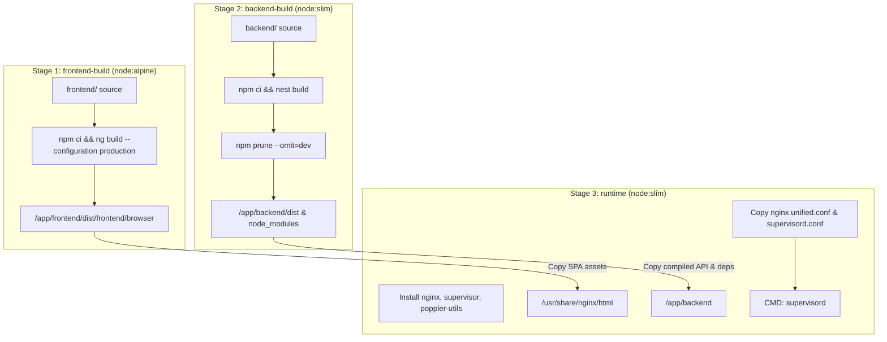

# Deployment, Containerization & CI/CD Pipelines

This document details the multi-stage Docker build architecture, process orchestration with Supervisor, Nginx reverse proxy configuration, Docker Compose setup, and GitHub Actions CI/CD workflows for **Dressly**.

---

## 1. Containerization Architecture

Dressly utilizes a single, unified Docker container that serves both the compiled Angular SPA frontend and the NestJS backend API.

### Multi-Stage Dockerfile (`Dockerfile`)



### Stage Summary
1. **`frontend-build`**:
   - Base image: `node:alpine` with `--mount=type=cache,target=/root/.npm`.
   - Builds optimized Angular production bundles into `/app/frontend/dist/frontend/browser/`.
2. **`backend-build`**:
   - Base image: `node:slim` with npm cache mounting.
   - Compiles TypeScript into JavaScript via `nest build`.
   - Prunes development dependencies with `npm prune --omit=dev --ignore-scripts` to minimize final image footprint.
3. **`runtime`**:
   - Base image: `node:slim`.
   - Installs system runtime dependencies: `nginx`, `supervisor`, and `poppler-utils`.
   - Copies frontend browser assets to `/usr/share/nginx/html/`.
   - Copies production backend code and dependencies to `/app/backend/`.
   - Injects unified configurations and sets entrypoint to Supervisor.

---

## 2. Process Orchestration (Supervisor)

Inside the container, **Supervisor** (`deploy/supervisord.conf`) orchestrates and monitors the two processes:

```ini
[supervisord]
nodaemon=true
logfile=/dev/null
pidfile=/tmp/supervisord.pid

[program:backend]
command=node /app/backend/dist/main
directory=/app/backend
autostart=true
autorestart=true
startretries=3
stdout_logfile=/dev/stdout
stdout_logfile_maxbytes=0
stderr_logfile=/dev/stderr
stderr_logfile_maxbytes=0

[program:nginx]
command=nginx -g "daemon off;"
autostart=true
autorestart=true
startretries=3
stdout_logfile=/dev/stdout
stdout_logfile_maxbytes=0
stderr_logfile=/dev/stderr
stderr_logfile_maxbytes=0
```

- **Resilience**: If either NestJS or Nginx crashes, Supervisor automatically restarts the process up to 3 times.
- **Log Streaming**: Both process output streams (`stdout` and `stderr`) are directed to `/dev/stdout` and `/dev/stderr`, allowing standard `docker logs` capture.

---

## 3. Nginx Reverse Proxy Configuration

The Nginx configuration (`deploy/nginx.unified.conf`) handles HTTP requests on port `8080`:

- **Upload Ceilings & Timeouts**:
  - `client_max_body_size 10m;` applied globally for standard photo attachments and wardrobe media uploads.
  - `client_max_body_size 2g;` and `proxy_read_timeout 600s;` dedicated to `location /api/backup/` to accommodate large multi-gigabyte disaster recovery archives containing full photographic wardrobes and prevent timeouts during streaming export or restore operations.
- **Health Check Passthrough**: Directs `GET /health` to NestJS `http://127.0.0.1:3000/health`.
- **API Passthrough**: Proxies `/api/` to `http://127.0.0.1:3000/` preserving `Host`, `X-Real-IP`, and `X-Forwarded-*` headers.
- **PWA Integrity**: Disables caching for `sw.js` and `manifest.webmanifest`.
- **Static Fingerprint Caching**: Sets `Cache-Control: "public, max-age=31536000, immutable"` on hashed `.js`, `.css`, and web font assets.
- **SPA Fallback**: Falls back to `/index.html` with `Cache-Control: "no-cache, no-store, must-revalidate"`.

---

## 4. Docker Compose Deployment

The project provides `docker-compose.yml` for unified local or production container execution:

```yaml
services:
  dressly:
    build:
      context: .
      dockerfile: Dockerfile
    image: ghcr.io/sorge13248/dressly
    container_name: dressly
    env_file:
      - .env
    environment:
      APP_PORT: 8080
      DB_PATH: /app/data/dressly.sqlite
      UPLOADS_DIR: /app/data/uploads
    ports:
      - "8080:8080"
    volumes:
      - dressly-backend-data:/app/data
      - ./config.json:/usr/share/nginx/html/config.json:ro
    healthcheck:
      test: ["CMD-SHELL", "wget -qO- http://127.0.0.1:8080/health >/dev/null || exit 1"]
      interval: 10s
      timeout: 3s
      retries: 5

volumes:
  dressly-backend-data:
```

### Running with Docker Compose
```bash
# Build and launch
docker compose up -d --build

# Inspect logs
docker compose logs -f dressly

# Stop container
docker compose down
```

---

## 5. Continuous Integration & Release Pipelines

Dressly features automated GitHub Actions workflows under `.github/workflows/`:

### 5.1. Multi-Architecture Docker Pipeline (`docker-multiarch.yml`)
Triggers on pushes to `main` with `v*` tags or pull requests impacting backend, frontend, or deployment files:
- **Matrix Strategy**:
  - Builds `linux/amd64` using `ubuntu-latest`.
  - Builds `linux/arm64` using native ARM runners (`ubuntu-24.04-arm`) for maximum compilation speed without QEMU emulation overhead.
- **Registry Publishing**: Pushes architecture-specific image digests to GitHub Container Registry (`ghcr.io`).
- **Manifest Merging**: Merges arch-specific digests into a unified multi-platform manifest tagged with `:latest` and `:vX.Y.Z`.

### 5.2. Automated Semantic Release Workflow (`release.yml`)
Triggered manually via `workflow_dispatch` by authorized maintainers:
1. Prompts for version bump type (`patch`, `minor`, `major`, or `custom`).
2. Calculates semantic version number.
3. Automatically updates version identifiers across:
   - Root `package.json`
   - `backend/package.json`
   - `frontend/package.json`
   - `frontend/public/sw.js` (`const VERSION = '...'`)
4. Merges `develop` into `main`.
5. Tags commit `vX.Y.Z` and pushes changes to GitHub.
6. Generates a formal GitHub Release with changelog summaries.
