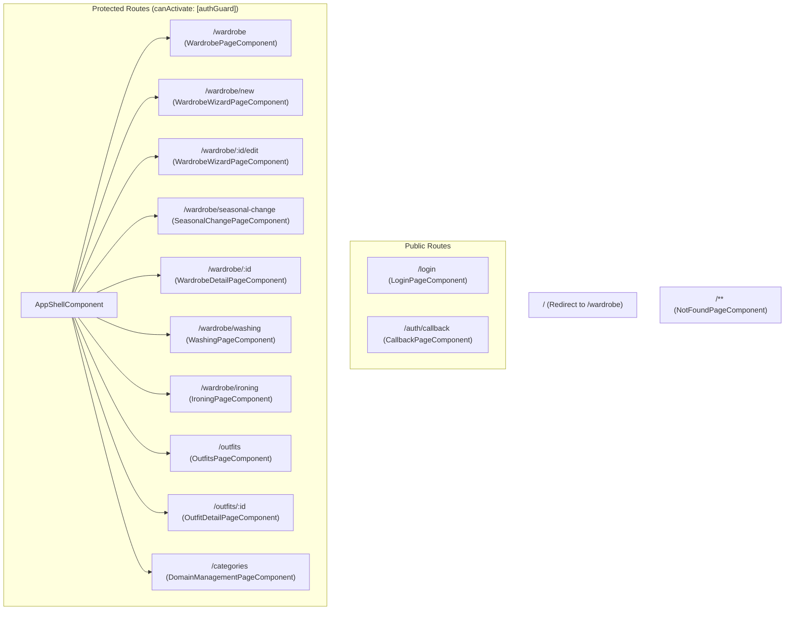
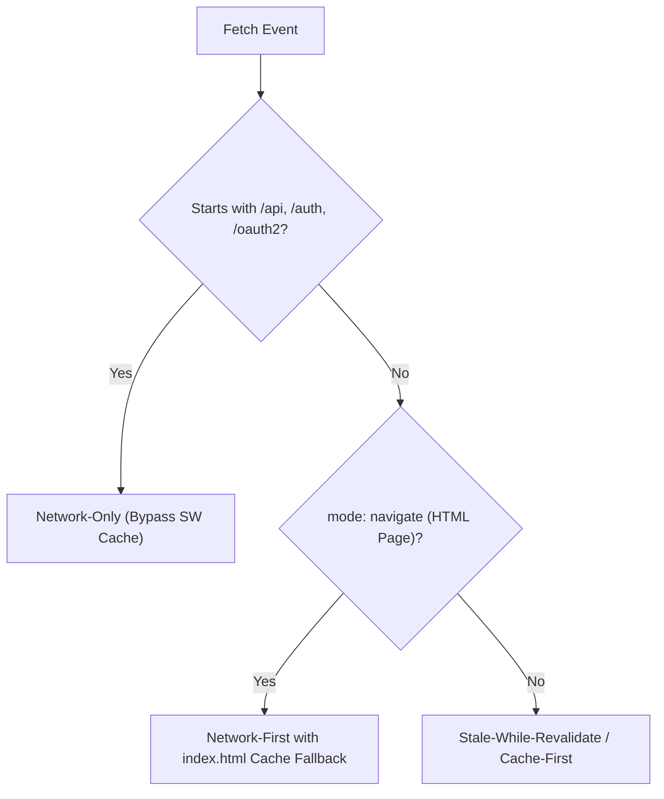

# Frontend Architecture & Client Engineering

This document outlines the frontend application structure, state management patterns, routing, styling architecture, and Progressive Web App (PWA) configuration in **Dressly** (`Angular 22`).

---

## 1. Architectural Philosophy

The Dressly frontend is built with **modern Angular 22** paradigms:
1. **100% Standalone Components**: The application is entirely free of `NgModule` boilerplate. Every component, directive, and pipe is standalone.
2. **Reactive State via Angular Signals**: UI components utilize Angular Signals (`signal()`, `computed()`, and `effect()`) for reactive rendering, minimal change detection cycles, and fine-grained state updates.
3. **No Heavy Third-Party UI Frameworks**: Rather than relying on heavy component libraries (like Angular Material or Bootstrap), Dressly employs a bespoke SCSS design token system coupled with **Angular CDK** (`@angular/cdk/dialog`, `@angular/cdk/overlay`) for accessible dialogs, overlays, and drag-and-drop primitives.
4. **Resilient Offline Shell (PWA)**: A custom Service Worker (`sw.js`) caches the application shell, while `OfflineStorageService` manages domain data in IndexedDB.

---

## 2. Directory Layout & Organization

The codebase under `frontend/src/app` is partitioned into distinct modular domains:

```text
frontend/src/app/
├── app.config.ts             # Application providers (HttpClient, Router, CDK)
├── app.routes.ts             # Application routing definitions & guards
├── core/                     # Singletons: auth, api, storage, sync, laundry, pwa
│   ├── api.service.ts
│   ├── auth.guard.ts
│   ├── auth.interceptor.ts
│   ├── auth.service.ts
│   ├── laundry.service.ts
│   ├── models.ts             # Shared TypeScript domain interfaces
│   ├── offline-storage.service.ts
│   ├── pwa-update.service.ts
│   ├── reference-store.service.ts
│   ├── sync.service.ts
│   └── toast.service.ts
├── layout/                   # Application shell & structural scaffolding
│   └── shell/
│       ├── shell.component.ts
│       ├── shell.component.html
│       └── shell.component.scss
├── features/                 # Domain feature page components
│   ├── auth/                 # Login & OAuth2/OIDC callback pages
│   ├── wardrobe/             # Main inventory, wizard editor, care queues
│   ├── outfits/              # Outfits grid, detail view, 2D canvas editor
│   ├── reference-data/       # Catalog & category management
│   └── errors/               # 404 Not Found & error boundaries
└── shared/                   # Reusable presentational components & utilities
    ├── components/           # Buttons, spinners, modals, select dropdowns, window-frame
    └── utils/                # Tag code validators, color utilities
```

---

## 3. Routing & Route Guards

Defined in `frontend/src/app/app.routes.ts`:



### Route Guards
- **`authGuard`**: Intercepts navigation to protected shell routes. If `authService.isAuthenticated()` is false, redirects to `/login`.
- **`canDeactivateWardrobeWizard`**: Detects unsaved modifications inside the clothing creation or editing wizard and displays a confirmation dialog before allowing navigation away. Integrates with the photo error recovery workflow: if photo upload fails during creation, the wizard transitions into edit mode (`Location.replaceState`), preserving in-memory files and guarding remaining pending photos against accidental loss.
- **`canDeactivateSeasonalChange`**: Detects unsaved selections or pending stage modifications in the Seasonal Wardrobe Rotation wizard and prompts the user with `ConfirmModalComponent` before allowing navigation away.

---

## 4. State Management & Service Architecture

| Service | Scope | Primary Role |
| :--- | :--- | :--- |
| `ApiService` | Root | Centralized HTTP client wrapping all REST endpoints with `credentials: 'include'`; handles binary stream downloads (PDF cards, ZIP backups) and multipart backup restoration. |
| `AuthService` | Root | Exposes user profile signal (`currentUser`), auth state (`isAuthenticated`), and login/logout methods. |
| `SyncService` | Root | Coordinates background synchronization, tracks online/offline state, processes sync queues, and surfaces sync status signals. |
| `OfflineStorageService` | Root | Low-level driver for the IndexedDB database (`dressly_offline_v1`); handles multi-criteria query/sorting engine (`queryClothes`), offline availability checks (`isTagCodeAvailable`), sync queues, and complete cache purging (`clearAllStores()`). |
| `LaundryService` | Root | Reactive store for clothes in washing and ironing queues. |
| `PwaUpdateService` | Root | Detects new Service Worker versions and triggers the update modal. |
| `ReferenceStoreService`| Root | Reactive cache of reference catalogs (colors, brands, tags, types). |
| `ToastService` | Root | Reactive queue for displaying transient toast alerts (success, error, warning). |

---

## 5. UI System & Design Tokens

Styling is implemented in `frontend/src/styles.scss` using CSS Custom Properties:

```scss
:root {
  --topbar-height: 73px;
  --bg: #1a3d7a;
  --surface: rgba(205, 226, 255, 0.75);
  --surface-strong: rgba(238, 247, 255, 0.96);
  --text: #1a1a2a;
  --muted: #5a6880;
  --line: rgba(255, 255, 255, 0.68);
  --line-dark: rgba(80, 130, 215, 0.28);
  --accent: #1e6dcf;
  --accent-strong: #0f49a8;
  --accent-soft: rgba(30, 109, 207, 0.13);
  --success: #2a7a4f;
  --danger: #c03040;
  --shadow: 0 6px 28px rgba(8, 28, 90, 0.32), inset 0 1px 0 rgba(255, 255, 255, 0.85);

  /* iOS / Mobile PWA Safe Area Insets */
  --safe-area-top: env(safe-area-inset-top, 0px);
  --safe-area-bottom: env(safe-area-inset-bottom, 0px);
  --safe-area-left: env(safe-area-inset-left, 0px);
  --safe-area-right: env(safe-area-inset-right, 0px);
}
```

### Responsive Breakpoints
- **Desktop**: `--topbar-height: 73px`
- **Tablet (`<= 960px`)**: `--topbar-height: 63px`
- **Mobile (`<= 640px`)**: `--topbar-height: 53px`, single-column stacked grids, touch-friendly tap targets (`min 44px`), and compact bottom floating action bars (e.g. wardrobe editor dock with icon-only step navigation buttons and hidden labels). The main wardrobe subnav (`.wardrobe-subnav`) features a smart accordion segmented control where inactive status tabs collapse to emoji icons (`🚪`, `📦`, `🏷️`, `🌍`) and only the active status tab displays its text label alongside an icon-only seasonal rotation button (`🔄`), guaranteeing zero horizontal overflow while preserving 1-tap status switching.

---

## 6. Progressive Web App (PWA) & Service Worker

The application includes a custom Service Worker (`frontend/public/sw.js`) and Web Manifest (`frontend/public/manifest.webmanifest`).

### 6.1. Service Worker Caching Strategies



1. **API & Auth Exemption**: All requests under `/api`, `/auth`, and `/oauth2` are deliberately bypassed from the service worker cache. Data caching is strictly managed by `SyncService` and `OfflineStorageService` in IndexedDB.
2. **Navigation (`mode: navigate`)**: Implements **Network-First**. If the network fails, it serves the cached `index.html` shell.
3. **Static Assets (`.js`, `.css`, images, fonts)**: Implements **Cache-First** or **Stale-While-Revalidate** with cache cleanup on activation.

### 6.2. Seamless In-App Updates (`PwaUpdateService`)
1. In development (`ng serve`), the service worker is automatically disabled and uninstalled to avoid interfering with Hot Module Replacement (HMR).
2. In production, `PwaUpdateService` listens for registration updates.
3. When a new service worker installation completes and enters the `waiting` state, `PwaUpdateService` opens `UpdateModalComponent`.
4. When the user clicks "Aggiorna ora" (Update now), the application sends a `SKIP_WAITING` message to the waiting worker and reloads the page.

---

## 7. Shared Components & Export Workflows

### 7.1. Backup & Disaster Recovery Modal (`BackupRestoreModalComponent`)
Located at `frontend/src/app/shared/components/backup-restore-modal/`, this standalone modal is accessible strictly from within the Domain Management view (`/categories`) to consolidate all system-level administration:

- **Live Data Metrics**: Calls `ApiService.getBackupStats()` on open to display real-time counts of clothes, outfits, reference data items, and total media storage footprint in MB.
- **Full ZIP Export**: Initiates streaming download of `dressly-backup-[userId]-[timestamp].zip` via `ApiService.downloadBackupZip()`.
- **Restoration Workflow**:
  - Drag-and-drop or manual file selection with automatic `.zip` validation and upload size warnings.
  - Interactive mode switch: **"Sostituisci tutto (consigliato per ripristino istanza)"** (`replace`) or **"Unisci ai dati esistenti"** (`merge`).
  - Upon successful server response, invokes `OfflineStorageService.clearAllStores()` to completely invalidate stale IndexedDB object stores before reloading the application shell to trigger an immediate clean re-sync.

### 7.2. Garment Technical Card PDF Export
Integrated into `WardrobeDetailPageComponent` (`detail-dock` action bar):
- Triggers `ApiService.downloadClothPdf(clothId)` to fetch a vector PDF generated server-side.
- Automatically handles binary blob streaming, creates a transient object URL (`window.URL.createObjectURL(blob)`), triggers native browser download naming the file `[code]_[name].pdf`, and releases memory via `revokeObjectURL`.

### 7.3. Unified Aero Window Frame Component (`WindowFrameComponent`)
Located at `frontend/src/app/shared/components/window-frame/` (selectors: `app-window-frame`, `app-window-shell`), this component encapsulates the Aero glassmorphism window layout, blue gradient header, and multi-slot content projection for top-level modal pages and wizards:

- **Aero Window Shell & Glass Frame**: Full-width viewport centering container with radial gradient background (`#eaf3fd` to `#f4f8fc`), high-contrast frosted glass border (`rgba(255, 255, 255, 0.95)`), outline, and deep layered drop shadows (`0 20px 48px -12px rgba(12, 45, 95, 0.22)`).
- **Aero Gradient Titlebar**: Standardized glossy header with drop-shadowed white typography, rounded glossy icon badge (`.title-icon-badge`), step/status badges, action slot, and close button with hover state and rotation transition emitting `(close)`.
- **Flexible Multi-Slot Projection**:
  - `[window-icon]`: Custom SVG or icon component inside the titlebar badge (with fallback to `icon` input).
  - `[window-title]`: Custom heading content if the string `title` input is omitted.
  - `[window-subtitle]`: Secondary badges, hints, or step pills alongside the title.
  - `[window-actions]`: Dedicated action buttons in the titlebar (e.g., Disaster Recovery / Backup & Restore button).
  - `[window-toolbar]`: Subheader bar directly beneath the titlebar (e.g., wizard stepper or domain category chips).
  - Default `<ng-content />`: The primary body area of the window.
  - `[window-footer]`: Bottom-pinned window footer.
  - `[window-dock]`: Floating action dock anchored outside the window frame within the viewport shell.
- **Shared Usage**: Shared consistently across Domain Management (`DomainManagementPageComponent`), Wardrobe Wizard (`WardrobeWizardPageComponent`), and Seasonal Rotation (`SeasonalChangePageComponent`).


