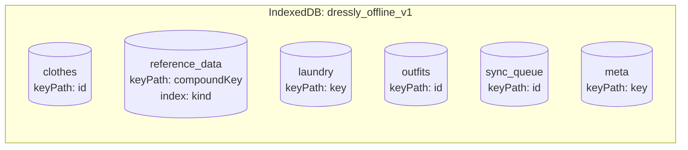
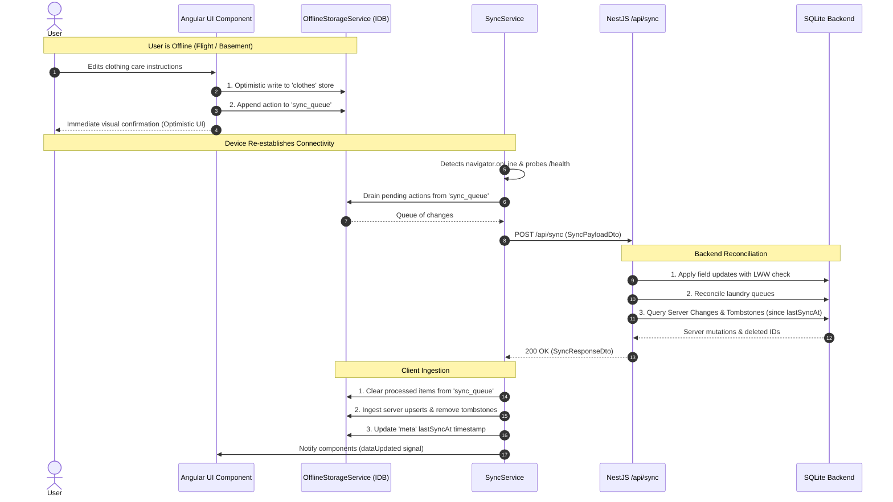

# Offline-First Architecture & Synchronization Engine

This document details the offline-first data model, browser IndexedDB storage layout, sync queue lifecycle, conflict resolution rules, and tombstone tracking system in **Dressly**.

---

## 1. Overview & Offline-First Philosophy

Dressly allows users to catalog clothes, review washing and ironing care instructions, manage laundry baskets, and arrange outfits even when disconnected from the network (e.g. in basements, laundromats, or during travel).

To accomplish this:
1. **Optimistic Local Storage**: User interactions immediately mutate an in-browser **IndexedDB** database.
2. **Persistent Queueing**: Offline mutations generate atomic change records stored in an IndexedDB `sync_queue`.
3. **Automatic Synchronization**: As soon as internet connectivity is restored (or confirmed via health check probes), the frontend packages queued changes and transmits them to `POST /api/sync`.
4. **Bi-directional Reconciliation**: The backend validates changes, applies field-level updates, detects and resolves conflicts using **Last-Write-Wins (LWW)**, and returns all server modifications made since the client's last sync timestamp.

---

## 2. Client-Side Storage: IndexedDB (`dressly_offline_v1`)

The client manages a dedicated IndexedDB database named `dressly_offline_v1` (Version 2) via `OfflineStorageService` (`frontend/src/app/core/offline-storage.service.ts`).

### Object Stores Layout



| Object Store | Key Path | Secondary Indexes | Description |
| :--- | :--- | :--- | :--- |
| `clothes` | `id` | — | Local replica of clothing items with populated relations; powers instantaneous offline tag code uniqueness verification (`isTagCodeAvailable`) |
| `reference_data` | `compoundKey` (`${kind}:${id}`) | `kind` | Local replica of catalogs (colors, brands, tags, rooms, locations, etc.) |
| `laundry` | `key` (`washing` or `ironing`) | — | Local queues of items currently in laundry |
| `outfits` | `id` | — | Local replica of outfits and 2D canvas layouts |
| `sync_queue` | `id` | — | Queue of pending mutations waiting for network transmission |
| `meta` | `key` | — | Metadata: `lastSyncAt`, `lastSyncStatus`, and conflict history |

### In-Memory Fallback
If IndexedDB is inaccessible (e.g. strict private browsing modes, disabled browser permissions, or test runners like Vitest), `OfflineStorageService` seamlessly falls back to an internal in-memory JavaScript `Map` store to ensure non-blocking UI behavior.

---

## 3. The Synchronization Protocol

### Sequence of an Offline Mutation and Reconnection



---

## 4. Payload Structures

### Client Transmission (`SyncPayloadDto`)
```typescript
export interface SyncPayloadDto {
  lastSyncAt: string | null; // ISO 8601 timestamp of last successful sync
  changes?: {
    referenceData?: ReferenceDataSyncInput[];
    clothes?: ClothesSyncInput[];
    laundry?: LaundrySyncInput;
    outfits?: OutfitSyncInput[];
  };
}
```

### Granular Clothes Mutation (`ClothesSyncInput`)
Rather than sending entire monolithic records, updates can specify granular field mutations:
```typescript
export interface ClothesSyncInput {
  id: string;
  action: 'create' | 'update' | 'delete';
  updatedAt: string; // Timestamp of mutation
  data?: Partial<ClothesItem>;
  fieldUpdates?: FieldUpdate[]; // Individual field timestamps for LWW
}

export interface FieldUpdate {
  field: string;
  value: unknown;
  updatedAt: string;
}
```

---

## 5. Conflict Resolution Mechanics

Conflict resolution in `backend/src/services/sync.service.ts` uses **Field-Level Last-Write-Wins (LWW)**:

### 5.1. Modification vs Modification
1. When the client submits an update for an entity that has also been modified on the server since `lastSyncAt`:
2. If the client supplies `fieldUpdates`, the server compares the timestamp of each individual field with the entity's `updatedAt`.
3. If the client field timestamp is newer than the server timestamp, the field update is applied.
4. If the server timestamp is newer, the server value is preserved, and a conflict entry is marked with `resolution: 'server_wins'`.
5. If both sides modified disjoint fields (e.g. client updated `notes`, server updated `size`), both changes are merged without conflict.

### 5.2. Modification vs Deletion
- If a client updates an item that was deleted on the server, the server deletion prevails.
- If a client deletes an item that was modified on the server, the deletion prevails and is recorded in the tombstone table.

---

## 6. Server-Side Tombstones (`sync_tombstones`)

Because SQLite removes records upon hard deletion (`DELETE FROM clothes WHERE id = :id`), an offline client would have no way of knowing that an item was deleted while it was disconnected.

To solve this, Dressly implements a **Tombstone** pattern:
1. Whenever an entity is deleted in `ClothesService`, `ReferenceDataService`, or `OutfitsService`, a record is inserted into `SyncTombstone`:
   ```typescript
   await this.dataSource.getRepository(SyncTombstone).save({
     userId: user.id,
     entityType: 'clothes', // 'colors', 'brands', 'outfit', etc.
     entityId: id,
     deletedAt: new Date(),
   });
   ```
2. When a client performs a sync with `lastSyncAt`, the server queries:
   ```sql
   SELECT entityId FROM sync_tombstones
   WHERE userId = :userId AND entityType = :type AND deletedAt > :lastSyncDate
   ```
3. The server sends these IDs in `serverChanges[entityType].deleted`.
4. The client's `OfflineStorageService` deletes the matching local records from IndexedDB.

---

## 7. Frontend Connection State Management

The frontend `SyncService` maintains real-time synchronization state via Angular signals:

| Signal / Computed | Type | Description |
| :--- | :--- | :--- |
| `status` | `Signal<SyncStatus>` | `'online-ok'` \| `'syncing'` \| `'conflict'` \| `'offline'` |
| `isOnline` | `Signal<boolean>` | Hardware network connectivity status |
| `pendingCount` | `Signal<number>` | Number of mutations currently waiting in `sync_queue` |
| `lastSyncTime` | `Signal<Date \| null>` | Timestamp of the last successful synchronization |
| `conflicts` | `Signal<SyncConflict[]>`| Unresolved or informational conflict records |

### Connection Health Probing
When the browser enters an offline state, `SyncService` starts an active health-probing timer against `GET /health` with exponential fallback. When the endpoint answers with `200 OK`, `markOnline()` triggers an immediate queue drain and synchronization cycle.
