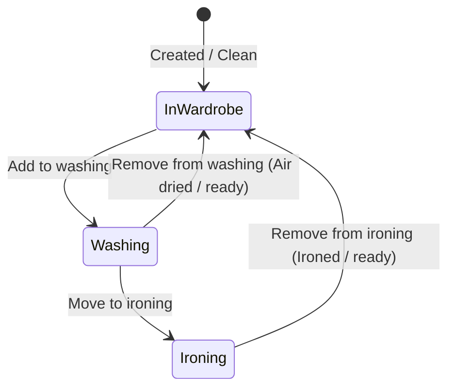
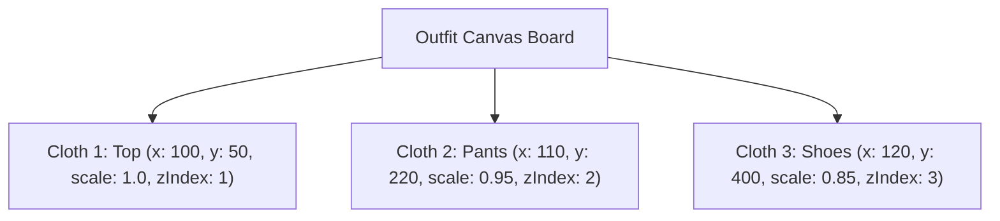
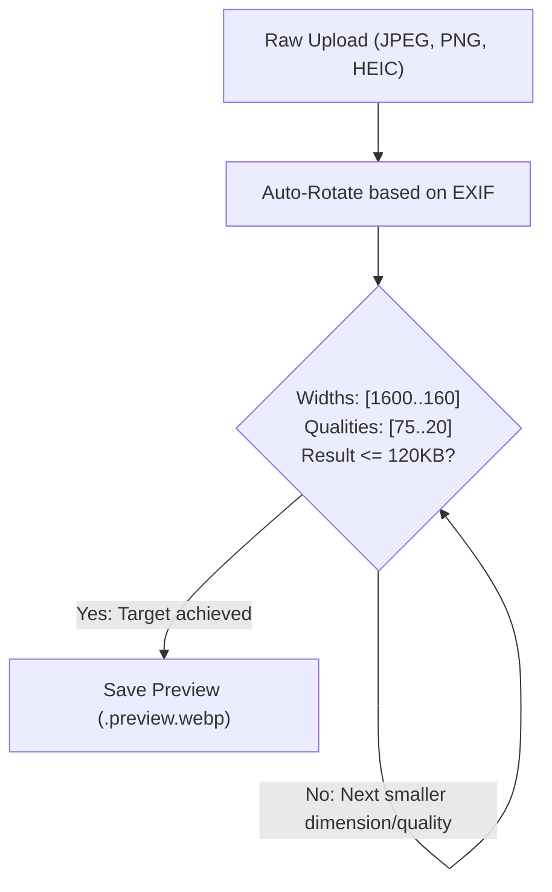

# Wardrobe Domain Logic & Advanced Features

This document provides a deep dive into the specialized domain systems in **Dressly**: the 3-Character Tag Code System, Laundry Lifecycle & Operational Queues, Outfits & Interactive 2D Canvas, and the Media Processing Pipeline.

---

## 1. The 3-Character Tag Code System

### 1.1. Motivation & Philosophy
To organize a physical wardrobe effectively, users often want to label physical garments (e.g. on care tags using textile laundry markers or heat-seal labels) without requiring expensive barcode scanners or QR code printers.

Dressly provides an ultra-compact **3-character code** for every clothing item (e.g., `K7P`, `9XB`, `E4M`).

### 1.2. The Marker-Friendly Character Set
To prevent human transcription errors when handwriting or reading codes on small fabric labels, Dressly defines a custom 30-character set in `backend/src/common/utils/tag-code.util.ts`:

```typescript
export const TAG_CODE_CHARSET = '23456789ABCDEFGHJKMNPQRSTVWXYZ';
export const TAG_CODE_LENGTH = 3;
```

#### Excluded Characters
- **`0` and `O`**: Visually indistinguishable on fabric.
- **`1`, `I`, and `L`**: Easily confused in handwritten or small-print text.
- **`U`**: Prone to confusion with `V` when handwritten.

### 1.3. Combinatorial Space & Collision Avoidance
- **Capacity**: $30^3 = 27,000$ unique combinations per user account.
- **Generation Strategy**:
  1. The generator generates a random 3-character string from the character set.
  2. If the candidate already exists in the user's active clothes list, it retries up to 200 times.
  3. If random collisions persist, it systematically traverses the character space from `222` to `ZZZ` to find the first unused code.
- **Database Enforcement**: SQLite enforces uniqueness with a composite index constraint:
  ```typescript
  @Unique(['userId', 'code'])
  ```

---

## 2. Laundry Management & Operational Queues

Dressly tracks garments through their active laundry lifecycle using two operational queues: **Washing** and **Ironing**.



### 2.1. Normal Items vs Cumulative Items
Garments can be classified into two operational types:

1. **Individual Items (`isCumulative: false`)**:
   - Represents a specific unique garment (e.g., a leather jacket or bespoke suit).
   - Quantity is always 1.
   - Appears at most once in either the washing or ironing queue.
2. **Cumulative Items (`isCumulative: true`, `quantity: N`)**:
   - Represents interchangeable stacked items (e.g., a pack of 5 identical black athletic socks or 3 plain white t-shirts).
   - `quantity` in `washing_items` or `ironing_items` tracks how many individual units from the stack are currently in laundry.
   - Adding to washing increments the queue quantity up to the total item `quantity`.
   - Removing from washing decrements the queue quantity.
   - The query parameter `?all=true` allows moving or clearing the entire stack at once.

### 2.2. Laundry Counters & Navigation Badges
The endpoint `GET /api/clothes/laundry-counts` provides real-time counts used by the Angular top navigation bar to display live notification badges:
```json
{
  "washing": 4,
  "ironing": 2
}
```

---

## 3. Outfits & Interactive 2D Canvas

Dressly enables users to assemble, preview, and organize clothing combinations into **Outfits**.

### 3.1. Outfit Data Composition
An outfit links:
- Curated member clothes (`outfit_clothes` relation).
- Contextual metadata (applicable seasons, temperatures, and use cases).
- Visual photo attachments or generated outfit collage previews.
- **Canvas Layout Coordinates** (`canvasLayout`).

### 3.2. 2D Interactive Canvas (`OutfitCanvasComponent`)
The outfit canvas allows users to visually compose looks on a 2D surface:



#### Coordinate & Transform Model
Each item on the canvas is assigned layout properties:
```typescript
export interface CanvasItemLayout {
  x: number;          // X coordinate relative to board container
  y: number;          // Y coordinate relative to board container
  scale?: number;     // Scaling factor (default: 1.0)
  rotation?: number;  // Rotation angle in degrees
  zIndex?: number;    // Stacking layer index
}
```

#### Advanced Canvas Interactions
- **Marquee Selection**: Users can drag a selection rectangle across the canvas board. The component computes bounding-box intersections to select multiple clothing items simultaneously.
- **Group Dragging**: Dragging any selected item moves the entire group while strictly maintaining relative spatial deltas between items.
- **Layer Stacking**: Selecting an item elevates its `zIndex` to the top of the canvas stack.
- **Persistence**: Clicking "Save Layout" serializes the layout mapping to `PATCH /api/outfits/:id`.

---

## 4. Media Processing Pipeline

Images uploaded to Dressly undergo automated processing via the `sharp` library (libvips) in `backend/src/services/clothes.service.ts`.

### 4.1. Upload Safeguards
- **File Size Limit**: Configured to **10MB** across all layers:
  - Frontend: Client-side file size verification before transmission.
  - Reverse Proxy: `client_max_body_size 10m;` in `deploy/nginx.unified.conf`.
  - Backend: Multer `limits: { fileSize: 10 * 1024 * 1024 }` on file interceptors.

### 4.2. WebP Preview Generation Algorithm
To ensure fast load times and minimal bandwidth consumption over mobile connections, every uploaded image is automatically processed into a progressive **WebP** preview:



1. **Auto-Orientation**: Rotates the image according to embedded EXIF orientation metadata (`sharp(buffer).rotate()`).
2. **Progressive Search**: Iterates through decreasing widths `[1600, 1200, 1000, 800, 640, 480, 320, 240, 160]` and quality steps `[75, 60, 50, 40, 30, 20]`.
3. **Target Constraint**: Halts as soon as the resulting WebP file is within the maximum preview byte budget (`MAX_PREVIEW_SIZE`), preserving optimal visual clarity with minimal bytes.
4. **Serving**: Clients can request `?variant=preview` to stream the lightweight WebP preview for cards and carousels, or omit the variant to stream the high-resolution original.
