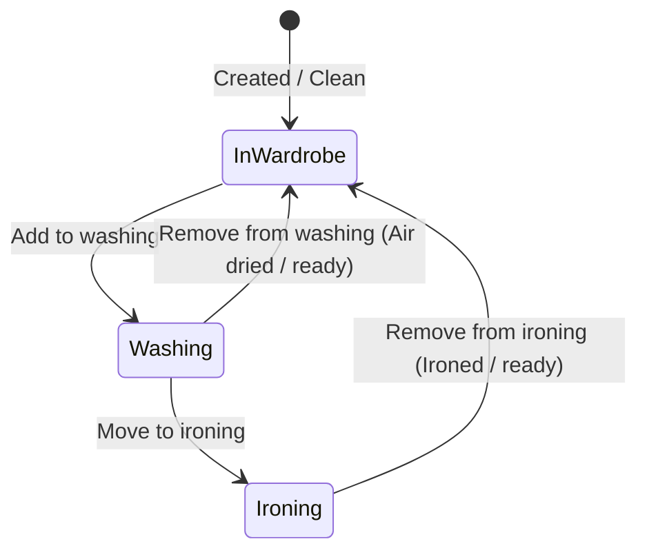
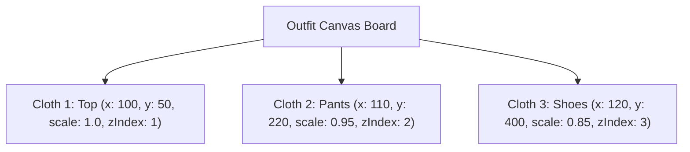
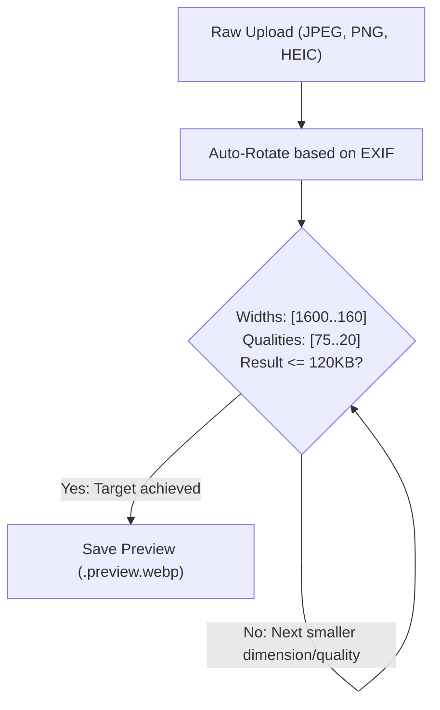
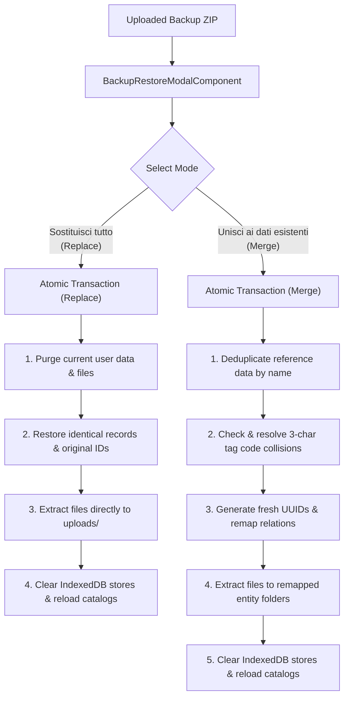

# Wardrobe Domain Logic & Advanced Features

This document provides a deep dive into the specialized domain systems in **Dressly**: the 3-Character Tag Code System, Laundry Lifecycle & Operational Queues, Outfits & Interactive 2D Canvas, the Media Processing Pipeline, and the Multi-Criteria Wardrobe Sorting Engine.

---

## 1. The 3-Character Tag Code System

### 1.1. Motivation & Philosophy
To organize a physical wardrobe effectively, users often want to label physical garments (e.g. on care tags using textile laundry markers or heat-seal labels) without requiring expensive barcode scanners or QR code printers.

Dressly provides an ultra-compact **3-character code** for every clothing item (e.g., `K7P`, `9XB`, `E4M`).

### 1.2. The Marker-Friendly Character Set
To prevent human transcription errors when handwriting or reading codes on small fabric labels, Dressly defines a custom 30-character set in `backend/src/common/utils/tag-code.util.ts`:

```typescript
export const TAG_CODE_CHARSET = '23456789ABCDEFGHJKMNPQRSTVWXYZ';
export const TAG_CODE_LENGTH = 3;
```

#### Excluded Characters
- **`0` and `O`**: Visually indistinguishable on fabric.
- **`1`, `I`, and `L`**: Easily confused in handwritten or small-print text.
- **`U`**: Prone to confusion with `V` when handwritten.

### 1.3. Combinatorial Space & Collision Avoidance
- **Capacity**: $30^3 = 27,000$ unique combinations per user account.
- **Generation Strategy**:
  1. The generator generates a random 3-character string from the character set.
  2. If the candidate already exists in the user's active clothes list, it retries up to 200 times.
  3. If random collisions persist, it systematically traverses the character space from `222` to `ZZZ` to find the first unused code.
- **Database Enforcement**: SQLite enforces uniqueness with a composite index constraint:
  ```typescript
  @Unique(['userId', 'code'])
  ```

### 1.4. Real-Time Offline Availability Verification (IndexedDB)
When creating or editing a garment in the wardrobe wizard (`/wardrobe/editor`), the ID Etichetta textbox verifies code availability dynamically against IndexedDB (`STORE_CLOTHES`) without requiring network API calls:
- **Instantaneous Feedback**: As the user types, characters are filtered to uppercase alphanumeric (maximum 3 characters).
- **Validation States**:
  - **Incomplete / Invalid (< 3 characters)**: Text in the input and the trailing status icon render in **red** with an **X** icon.
  - **Available / Free (3 characters, unused)**: Resolved locally against `OfflineStorageService.isTagCodeAvailable()`. The textbox text and trailing status icon render in **green** with a **V** (checkmark) icon.
  - **Collision / Already Taken (3 characters, already assigned to another garment)**: Text in the input and the trailing status icon render in **red** with an **X** icon and display the validation error message `"Codice già utilizzato"`.
- **Edit Mode Awareness (`excludeId`)**: When editing an existing piece (`/wardrobe/editor/:id`), the garment's own tag code is excluded from collision checks, remaining available and green.
- **Workflow Gate**: The wizard disallows stepping forward from step 1 and blocks saving whenever the tag code is taken or incomplete.

### 1.5. Wizard Navigation & Floating Dock Actions
The clothing editor wizard (`/wardrobe/editor` and `/wardrobe/editor/:id`) features a persistent glassmorphic bottom floating dock (`wizard-dock.floating-dock`) providing immediate step navigation and saving controls:
- **Desktop Layout**: Displays close action ("Chiudi"), vertical separator, previous step button ("Indietro" with left chevron), next step button ("Avanti" with right chevron, rendered when `currentStep < 5`), and primary save button ("Crea" / "Aggiorna" with save icon).
- **Mobile Responsive Layout (`<= 640px`)**: The dock adapts into an ergonomic centered toolbar with adjusted spacing (`gap: 8px`):
  - Secondary elements like "Chiudi" and the separator are hidden to optimize horizontal space.
  - Navigation buttons **"Indietro"** (`.dock-btn-prev`) and **"Avanti"** (`.dock-btn-next`) render in a compact circular form factor (38×38 px) displaying **only their icons without text labels**.
  - Accessible names (`aria-label="Indietro"` and `aria-label="Avanti"`) and hover `title` tooltips remain fully active for assistive technologies.
  - The primary save button (`.dock-btn-save`) remains prominent with its icon and responsive label.

### 1.6. Photo Upload Error Handling & Resilience Flow
When creating or editing a garment with photo attachments in the wardrobe wizard (`/wardrobe/new` and `/wardrobe/:id/edit`), photo uploads are executed with granular failure diagnostics and automatic recovery:
- **Two-Stage Persistence**: The garment base record is committed to SQLite first. If creation succeeds but one or more attachments fail during subsequent upload:
  - The wizard **does not discard the created garment** and does not navigate away to the detail page.
  - The wizard automatically switches into **Edit Mode** (`editingId = clothesId`).
  - The browser URL is seamlessly updated to `/wardrobe/:clothesId/edit` using Angular `Location.replaceState()`, preserving in-memory `File` references and state without triggering component destruction or route reloads.
  - The wizard transitions to **Step 5 ("Foto")** with the primary action button displaying `"Aggiorna"`.
- **Deduplication & Partitioning**:
  - Attachments that uploaded successfully are converted to existing items (`source: 'existing'`) with their returned server IDs.
  - Failed attachments remain in pending state (`source: 'pending'`), preventing duplicate uploads on retry.
- **Pinpoint Diagnostic Feedback**:
  - Failed photos display a prominent red border and a dedicated error pill (`.photo-error-badge`) with the exact cause of failure (e.g. `HTTP 413`: *"File troppo grande: limite massimo 10MB"*, `HTTP 0`: *"Errore di connessione o rete non disponibile"*, `HTTP 401`: *"Sessione scaduta"*, or server-returned validation messages).
  - An inline error callout banner (`.photo-errors-callout`) on Step 5 enumerates each failed photo by name alongside its precise cause.
- **Immediate Retry or Removal**: The user can delete the failing photo with the `✕` button or immediately retry uploading all remaining pending items by clicking `"Aggiorna"`.

### 1.7. Custom Dropdowns with Selection Clearance in Wizard Editor
Throughout the clothing wizard editor (`/wardrobe/new` and `/wardrobe/:id/edit`), optional garment properties (brand, fit, garment type, storage location, care parameters) utilize custom selection dropdowns (`app-select-dropdown`) with full cancellation capability:
- **Direct Trigger Clear Button**: As soon as a brand, fit, or location is selected, an inline circular clear button (`✕`, `title="Annulla selezione"`) appears on the right edge of the combobox trigger. Clicking it clears the selection with 1 click without opening the dropdown overlay.
- **In-Panel Selection Cancellation**: Users who open the dropdown can cancel their selection by clicking the currently highlighted option to toggle it off, or by selecting the dedicated `"Nessun brand"`, `"Nessun fit"`, `"Nessun tipo"`, or `"Nessuna posizione"` entry in the list.
- **Keyboard Deselection**: Pressing `Backspace` or `Delete` while the trigger is focused instantly resets the field to empty.
- **Form State Compatibility**: Deselecting sets the form model value to `''`, which is automatically normalized to `null` in the API persistence payload (`brand_id || null`, `fit_id || null`, `type_id || null`, `location_id || null`).

### 1.8. Washing Machine Programs, Detergents & Tri-State Color Bleed
- **Washing Programs Domain**: The `washing-programs` reference domain configures washing machine presets with name, temperature (validated 0-95°C), and spin speed (`centrifuga`, numeric $\ge 0$ rpm). In the wizard editor, selecting a preset automatically hides and clears the manual free temperature input.
- **Detergents Domain**: The `detergents` reference domain configures detergents and specialized cleaning agents with name and descriptive usage guidelines. The detergent selector is available for both machine wash and hand wash. Both new domains support manual drag-and-drop reordering and an automatic alphabetical sorting button.
- **Tri-State Color Bleed Control**: The washing instructions "Perde colore" toggle cycles through three distinct states in sequence:
  - `null` (⚪ Non testato): Unverified; no warning badge rendered.
  - `0` (🛡️ Non perde colore): Confirmed colorfast; renders safe badge on garment detail.
  - `1` (⚠️ Perde colore): Known color bleeding risk; renders warning badges across garment detail and washing queue cards.
- **Washing Notes**: An optional free-text notes field in the washing care editor and garment detail view allows recording specific laundering recommendations, special rinse cycles, or fabric-specific precautions.
- **Contextual Browser Window Titles**: Every application route and view sets a clear, informative `<title>` reflecting the active functional area (e.g. `Guardaroba - Dressly`, `Capi da lavare - Dressly`, `Gestione domini - Dressly`) and dynamic garment/outfit details (`[Nome Capo] - Dressly`, `Modifica [Nome Capo] - Dressly`).


---

## 2. Laundry Management & Operational Queues

Dressly tracks garments through their active laundry lifecycle using two operational queues: **Washing** and **Ironing**.



### 2.1. Normal Items vs Cumulative Items
Garments can be classified into two operational types:

1. **Individual Items (`isCumulative: false`)**:
   - Represents a specific unique garment (e.g., a leather jacket or bespoke suit).
   - Quantity is always 1.
   - Appears at most once in either the washing or ironing queue.
2. **Cumulative Items (`isCumulative: true`, `quantity: N`)**:
   - Represents interchangeable stacked items (e.g., a pack of 5 identical black athletic socks or 3 plain white t-shirts).
   - `quantity` in `washing_items` or `ironing_items` tracks how many individual units from the stack are currently in laundry.
   - Adding to washing increments the queue quantity up to the total item `quantity`.
   - Removing from washing decrements the queue quantity.
   - The query parameter `?all=true` allows moving or clearing the entire stack at once.

### 2.2. Laundry Counters & Navigation Badges
The endpoint `GET /api/clothes/laundry-counts` provides real-time counts used by the Angular top navigation bar to display live notification badges:
```json
{
  "washing": 4,
  "ironing": 2
}
```

---

## 3. Outfits & Interactive 2D Canvas

Dressly enables users to assemble, preview, and organize clothing combinations into **Outfits**.

### 3.1. Outfit Data Composition
An outfit links:
- Curated member clothes (`outfit_clothes` relation).
- Contextual metadata (applicable seasons, temperatures, and use cases).
- Visual photo attachments or generated outfit collage previews.
- **Canvas Layout Coordinates** (`canvasLayout`).

### 3.2. 2D Interactive Canvas (`OutfitCanvasComponent`)
The outfit canvas allows users to visually compose looks on a 2D surface:



#### Coordinate & Transform Model
Each item on the canvas is assigned layout properties:
```typescript
export interface CanvasItemLayout {
  x: number;          // X coordinate relative to board container
  y: number;          // Y coordinate relative to board container
  scale?: number;     // Scaling factor (default: 1.0)
  rotation?: number;  // Rotation angle in degrees
  zIndex?: number;    // Stacking layer index
}
```

#### Advanced Canvas Interactions
- **Marquee Selection**: Users can drag a selection rectangle across the canvas board. The component computes bounding-box intersections to select multiple clothing items simultaneously.
- **Group Dragging**: Dragging any selected item moves the entire group while strictly maintaining relative spatial deltas between items.
- **Layer Stacking**: Selecting an item elevates its `zIndex` to the top of the canvas stack.
- **Persistence**: Clicking "Save Layout" serializes the layout mapping to `PATCH /api/outfits/:id`.

---

## 4. Media Processing Pipeline

Images uploaded to Dressly undergo automated processing via the `sharp` library (libvips) in `backend/src/services/clothes.service.ts`.

### 4.1. Upload Safeguards
- **File Size Limit**: Configured to **10MB** across all layers:
  - Frontend: Client-side file size verification before transmission.
  - Reverse Proxy: `client_max_body_size 10m;` in `deploy/nginx.unified.conf`.
  - Backend: Multer `limits: { fileSize: 10 * 1024 * 1024 }` on file interceptors.

### 4.2. WebP Preview Generation Algorithm
To ensure fast load times and minimal bandwidth consumption over mobile connections, every uploaded image is automatically processed into a progressive **WebP** preview:



1. **Auto-Orientation**: Rotates the image according to embedded EXIF orientation metadata (`sharp(buffer).rotate()`).
2. **Progressive Search**: Iterates through decreasing widths `[1600, 1200, 1000, 800, 640, 480, 320, 240, 160]` and quality steps `[75, 60, 50, 40, 30, 20]`.
3. **Target Constraint**: Halts as soon as the resulting WebP file is within the maximum preview byte budget (`MAX_PREVIEW_SIZE`), preserving optimal visual clarity with minimal bytes.
4. **Serving**: Clients can request `?variant=preview` to stream the lightweight WebP preview for cards and carousels, or omit the variant to stream the high-resolution original.

### 4.3. Deterministic Primary Photo Resolution & Sort Order
When a garment has multiple attachments, each attachment carries a `sortOrder` index. Both backend services (`ClothesService.list`, `getOne`, and `SyncService.getChangesSince`) and frontend components (`ClothesCardComponent`, `MainComponent`, `OutfitCanvasComponent`, and `OfflineStorageService`) deterministically order attachments by `sortOrder ASC` (and `createdAt ASC`). Primary preview selectors (`getPrimaryAttachment`) consistently pick the primary image (`sortOrder: 0`) across wardrobe grids, canvas outfits, laundry baskets, and detail sheets.

---

## 5. Multi-Criteria Wardrobe Sorting Engine

Dressly equips the primary wardrobe gallery with a multi-criteria sorting engine that operates synchronously across both local-first offline storage (IndexedDB) and the backend database (SQLite).

### 5.1. Sorting Criteria & Domain Semantics

| Sort Key (`sort`) | UI Label | Behavior |
| :--- | :--- | :--- |
| `created_desc` *(Default)* | Più recenti | Orders by `createdAt DESC`. Newly cataloged pieces appear first. |
| `created_asc` | Meno recenti | Orders by `createdAt ASC`. Oldest inventory items appear first. |
| `name_asc` | Nome (A → Z) | Lexicographical order based on `item.name` with fallback to computed `fullTitle` and clothing type. |
| `name_desc` | Nome (Z → A) | Reverse lexicographical order. |
| `type_order` | Tipologia (ordine armadio) | Hierarchy representing natural physical wardrobe order: Tops (10) → Knitwear/Mid-layers (20) → Outerwear (30) → Bottoms (40) → Full-body dresses/suits (50) → Underwear/Loungewear (60) → Footwear (70) → Other (90). |
| `type_asc` | Tipologia (A → Z) | Alphabetical ordering by type name. |
| `season_current` | Stagione corrente prima | Evaluates the current astronomical season from the date. Clothes tagged with the current season or marked "Tutte le stagioni" are prioritized, pushing off-season items to the bottom. |
| `season_cycle` | Stagione (ciclo annuale) | Progresses along the standard meteorological calendar cycle (Autumn → Winter → Spring → Summer). |
| `code_asc` | Codice etichetta (A → Z) | Orders items by the 3-character tag code (`code ASC`), placing items without an assigned code at the end. Designed for physical closet scanning. |
| `availability` | Disponibili prima (puliti) | Elevates clean and available garments (not queued in washing or ironing), followed by items queued in ironing, and lastly items in washing. |

### 5.2. UI Integration & Persistence
- **Floating Dock Component**: Accessible directly from the glassmorphic bottom navigation dock alongside free-text search, filter toggle, and pagination.
- **Global Search Box with Clear Button**: The free-text search input in the home page floating dock matches across garment names, brand names, 3-character tag codes, and notes in real time with debouncing (250ms). Whenever search text is present, an inline clear button (`✕`, `aria-label="Cancella ricerca"`) appears on the right inside the input field. Clicking this button immediately clears the search model, resets debounced search, resets pagination to page 1, and restores focus to the input.
- **Bi-Directional URL Synchronization**: The active sort criterion is mirrored to the URL query string (`?sort=<key>`) for shareable and bookmarkable links.
- **Local Storage Preference**: The user's selection is persisted in `localStorage` under `dressly_wardrobe_sort`, automatically restoring their preferred ordering on subsequent visits.

---

## 6. Seasonal Wardrobe Rotation, Storage Locations & Decluttering

To mirror the real-world ritual of seasonal wardrobe rotation (*"cambio dell'armadio"*), Dressly models garment lifecycle states and physical storage containers.

### 6.1. Operational Garment Statuses

Every garment in Dressly operates in one of three mutually exclusive lifecycle statuses:

| Status (`status`) | UI Label | Behavior & Visibility |
| :--- | :--- | :--- |
| `in_wardrobe` *(Default)* | Nell'armadio | Active garments currently hanging in the user's primary closet and readily available for daily outfits. |
| `in_storage` | In deposito | Off-season or archived garments stored away in physical containers, boxes, or auxiliary rooms. Displays location badge (e.g. `📦 Soffitta › Scatola Lana`). |
| `dismissed` | Dismesso | Garments that have been donated, sold, handed down, or recycled during decluttering. Retained in historical records without cluttering active views. |

### 6.2. Storage Hierarchy: Rooms & Locations

Physical storage is structured hierarchically:
- **Rooms (`Room`, `rooms`)**: Physical spaces in the home (e.g., *Camera da letto*, *Soffitta*, *Cantina*, *Ripostiglio*).
- **Locations (`Location`, `locations`)**: Specific boxes, bags, or shelves within a room (e.g., *Scatola Lana 1*, *Scatola Sottovuoto*, *Armadio Ospiti*). Each location references its parent `Room`.
- When assigned to a garment, the system tracks `locationId` and displays breadcrumb badges (`📦 Room › Location`).

### 6.3. Operational Workflows & Responsive Subnav

1. **Main Wardrobe Status Navigation (`.wardrobe-subnav`)**: The main clothes gallery (`/wardrobe`) embeds an immediate 1-tap status selector (`in_wardrobe`, `in_storage`, `dismissed`, `all`) and a direct launch button for the seasonal change wizard:
   - **Desktop**: Displays full labels and icons across all 4 status tabs and the seasonal rotation action button.
   - **Mobile (`<= 640px`)**: Employs a smart accordion layout where inactive tabs collapse to their emoji icons (`🚪`, `📦`, `🏷️`, `🌍`), only the currently active tab expands to show its text label, and the seasonal change action collapses to a compact icon button (`🔄`) with accessible `title` and `aria-label`. This guarantees single-row presentation with zero horizontal scrolling and no overflow even on 320px screens.
2. **Fast Multi-Select Actions**: From the main wardrobe gallery, selecting multiple items surfaces bulk actions in the command bar:
   - `📦 In deposito...`: Prompts for target location and moves selected items to `in_storage`.
   - `🚪 Nell'armadio`: Restores selected items to active wardrobe (`in_wardrobe`) and clears location.
   - `🏷️ Dismetti`: Confirms and flags selected items as `dismissed`.
2. **Dedicated Seasonal Change Wizard (`/wardrobe/seasonal-change`)**:
   A guided 5-step interactive workflow protected by `canDeactivateSeasonalChange` to guard against accidental loss of unsaved changes:
   - **Step 1 (Stagioni)**: Multi-selection of outgoing seasons to pack away and incoming seasons to unpack. Multi-season garments suitable for incoming seasons are automatically preserved in the active wardrobe.
   - **Step 2 (In Deposito)**: Displays active garments matching any selected outgoing season (excluding multi-season garments that also match incoming seasons) rendered using compact mini cards (`ClothesCardComponent` variant="mini" with photo on the left, details and direct "open in new tab" button on the right, and quick actions disabled), target location selector, and optional checkbox to send items to the washing queue.
   - **Step 3 (Nell'Armadio)**: Displays stored garments matching any selected incoming season with container origin badges and optional checkbox to send extracted garments to the ironing queue.
   - **Step 4 (Decluttering)**: Rapid review with mini cards to mark unwanted garments as dismissed (donated, sold, or recycled).
   - **Step 5 (Conferma)**: Visual summary cards and atomic batch execution.
3. **Outfit Storage Warnings**: Outfits containing garments currently `in_storage` display an alert badge (e.g., `📦 1 capo in deposito: Scatola Lana`) in grid cards and detail views while still permitting composition and layout planning.

---

## 7. Print-Ready Vector PDF Export

Dressly enables exporting a comprehensive, beautifully styled technical specification sheet for any clothing piece directly from the item detail page (`/wardrobe/:id`).

### 7.1. Floating Dock Action
The floating action dock (`aside.detail-dock`) provides a dedicated **"Esporta PDF"** button with real-time loading feedback. Clicking the action invokes `GET /api/clothes/:id/pdf` to stream a vector PDF document directly to the browser.

### 7.2. Document Visual Layout
The generated A4 PDF is produced using `PDFKit` on the backend, complemented by `Sharp` for converting uploaded photos (WebP, PNG, JPEG) into high-fidelity embedded imagery:
- **Header Bar**: Dressly brand mark, technical sheet title, generation date, and a prominent rounded pill displaying the 3-character tag code (`[ 7KX ]`).
- **Hero Two-Column Block**:
  - **Left**: Primary photo framed in a bordered card container (or placeholder text if no photo is attached).
  - **Right**: Garment title, operational status badge (`Nell'armadio`, `In Deposito: Stanza › Contenitore`, or `Dismesso`), laundry state chips, and key attributes (Size, Quantity, Brand, Category, Fit, Seasons, Temperatures, Occasions, Colors with visual hex-filled circles, Materials, and Tags).
- **Personal Notes**: Stylized callout box for user notes.
- **4-Panel Care & Maintenance Grid**:
  - **Lavaggio**: Machine/hand wash mode, maximum temperature (°C or cold wash), bleach allowance, inside-out and zip closure instructions.
  - **Asciugatura**: Tumble dryer allowance and temperature level (* / ** / ***), drying method (line dry, flat dry, in shade).
  - **Stiratura**: Ironing mode (with or without steam, forbidden), iron heat level (110°C / 150°C / 200°C), reverse-side ironing.
  - **Acquisto**: Purchase store, acquisition date, price formatted in Euros, and store link.
- **Secondary Photo Gallery**: Thumbnail row displaying up to 4 additional garment attachments.
- **Footer**: Brand credit and page pagination.

---

## 8. Portable ZIP Backup & Multi-Instance Disaster Recovery

To guarantee long-term data sovereignty, Dressly provides a full backup export and restoration engine accessible directly from the **Gestione domini** (`DomainManagementPageComponent`) page.

### 8.1. Full ZIP Archive Format
The backup export (`GET /api/backup/export`) packages all data belonging to the authenticated user into a self-contained `.zip` archive:
- `manifest.json`: Schema metadata, app version (`1.6.0`), export timestamp, user identifier, and statistical counts.
- `data/reference-data.json`: All custom catalogs (brands, colors with hex codes, fits, materials, seasons, tags, temperatures, types, use cases, rooms, and storage locations).
- `data/clothes.json`: Full inventory records with 1:1 nested instructions (`washingInstruction`, `dryingInstruction`, `ironingInstruction`, `buyDetail`), N:M relationships, and attachment metadata.
- `data/outfits.json`: Outfit definitions with 2D canvas layouts, clothing associations, and context tags.
- `data/laundry.json`: Active washing and ironing queues.
- `files/clothes/{clothesId}/*`: Master photo files (WebP previews `*.preview.webp` are excluded from the archive to keep export lightweight; the backend regenerates them on demand upon first request).
- `files/outfits/{outfitId}/*`: Master outfit attachments (previews regenerated dynamically on demand).

### 8.2. Dual Restoration Engine (`POST /api/backup/restore`)
Users can restore a backup ZIP onto a fresh or existing Dressly instance with a choice between two operational strategies:



1. **Sostituisci tutto (`replace`)**:
   - Designed for disaster recovery or importing onto a fresh Dressly instance.
   - Clears existing laundry queues, outfits, clothes, storage locations, rooms, and custom reference catalogs for the user.
   - Restores records using original entity IDs whenever available, and extracts files directly into the destination storage tree.
   - Protected by an explicit confirmation checkbox in the UI.
2. **Unisci ai dati esistenti (`merge`)**:
   - Designed for combining wardrobes or importing collections without losing current garments.
   - Deduplicates reference catalogs: existing colors, brands, and types matching by name are reused, while new ones are created.
   - Automatically detects and resolves 3-character tag code collisions using `generateUniqueTagCode` against the unambiguous charset (`23456789ABCDEFGHJKMNPQRSTVWXYZ`).
   - Resolves clothes name conflicts by appending `(importato)`.
   - Generates fresh UUIDs and re-maps relations atomically.

### 8.3. Offline Synchronization Alignment
Upon completing a restore, the frontend resets all local IndexedDB stores (`clearAllStores()`) and triggers a fresh catalog reload (`ReferenceStoreService.loadAll()`), ensuring zero stale cache or synchronization divergence.


